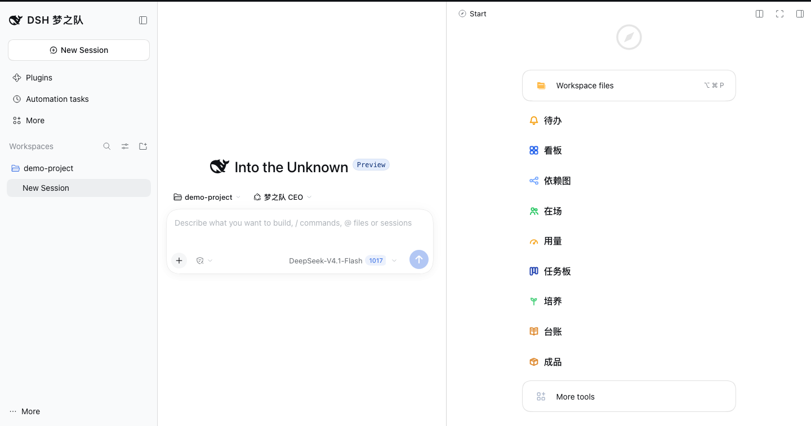
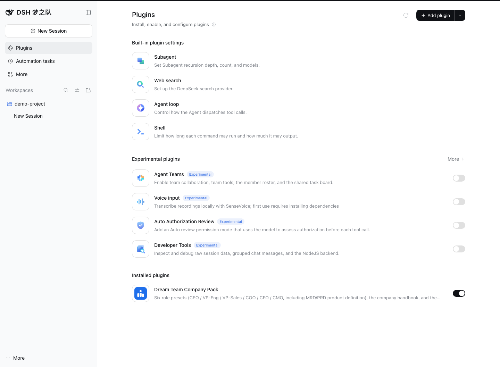

# 梦之队（dsh-company-pack）

给一个项目配一间**六人虚拟公司**：CEO 接你的动议，按需要叫上工程、销售、运营、财务、市场，
开一场会式的经营判断，最后把可交付的成品写进你的项目目录。它装在 DSH 里用——不是独立 App，
也不是一键托管的全自动公司。

## 你会得到什么

- **六个角色，各有岗位**：CEO 做取舍与合稿；工程、销售、运营、财务、市场各自从本职能判断，分歧被保留。
- **一场会议式的经营判断**：澄清目标 → 拆任务与依赖 → 派成员 → 互审 → 合稿，过程在任务板和成员会话里看得见。
- **产品定义链路**：从市场需求（MRD）到产品需求（PRD），再到系统需求与测试用例，编号可追溯。
- **产物和记忆都在项目里**：成品、公司知识库、日志、培养记录写进 `<项目>/.dsh-company/`，换项目不重装。

## 这家公司的六个角色

| 角色 | 管什么 |
|---|---|
| 梦之队 CEO | 接动议、澄清目标、拆任务、合稿与拍板 |
| VP-Eng | 工程可行性、技术方案、系统与测试 |
| VP-Sales | 市场、客户、定价与销售判断 |
| COO | 交付承接、产能、运营与流程 |
| CFO | 毛利、预算、合规与签字线 |
| CMO | 市场洞察、MRD、增长与品牌 |

## 5 分钟装好

需要：**DSH**（版本 `>=0.2.1-rc.2 <0.3.0`，先跑 `dsh --version` 确认）· 一个**项目目录** · 能装包的网络
· DSH 里已配好模型凭据（**Settings → Models** 填 DeepSeek API Key）。
Desktop 自带 Node/pnpm；命令行版 DSH 需 pnpm 在 PATH（或 `corepack enable pnpm`）。

**第一条命令**：`dsh --version`——确认 DSH 在版本窗口内；安装本身是界面操作，见下面三步。

1. 打开 DSH 的 **Plugins** 页 → **Add plugin**，输入包名 `dsh-company-pack`；未发布时粘贴安装包
   （`.tgz`）的**绝对路径**——本版本尚未发布到 registry，没有包名可装时向发布方索取安装包（没有渠道就去仓库 issue 要）。
2. 若提示重启，按提示重启**当前这个 profile**（DSH 里的一套已装插件与配置）；装进哪个入口，就从哪个入口启动。
3. 用同一个入口重新打开 DSH。

**装好的标志**：Plugins 页的 **Installed plugins** 里出现「Dream Team Company Pack」（包名 `dsh-company-pack`）
且已启用；侧栏品牌变成「DSH 梦之队」；新建会话默认角色是「梦之队 CEO」，右栏菜单里出现公司页签。
三样都在 = 装好了。命令行安装见《安装手册》附录 A。

## 第一次经营一家公司

1. **选项目目录**：在 DSH 里点 **Choose workspace / Add workspace** 选中你的项目；公司只在这个目录里读写。
2. **对 CEO 说一句话**：新建会话（默认「梦之队 CEO」），把动议原样发过去，例如
   「下季度我们想把 <一件事> 做成付费功能。先问清目标和约束，再判断值不值得做、怎么定价、团队接不接得住。」
3. **回答澄清**：CEO 会先问清目标、约束与验收，不会立刻开写；把答案回给它。
4. **看它组队**：CEO 拆任务、标依赖、拉起成员。右栏 **任务板** 出现卡片，**在场** 出现成员与状态。
   需要你批的操作（比如执行命令）会进右栏 **待办**：点开批/拒，它才会继续。
5. **进成员的空间**：会话头部点 **Team 名册**，或从 **在场** 点成员那一行，看它读公司知识、怎么出稿。
6. **收成品**：CEO 合稿后给交付卡片；文件在 `<项目>/.dsh-company/deliverables/<日期>-<slug>/final.md`，
   右栏 **成品** 也能按 final 列出来。

小动议通常几分钟到十几分钟，会调用多次模型；右栏 **用量** 看令牌消耗。成员之间的分歧会保留在 final 里。

## 产物在哪

全部公司状态都在 `<项目>/.dsh-company/`：

- `deliverables/`：成品，按 `<日期>-<slug>/` 归档，`final.md` 是定稿，`drafts/` 是过程稿；
- `kb/`：公司知识、各角色章程、任务台账与 journal；
- `logs/`、`exports/`、`cultivation/`：运行日志、导出、角色培养记录；
- `bundle.json`：这份公司状态的创建信息。

插件本身在 DSH 的安装目录里、只读；DSH 的会话与凭据在 DSH 自己的目录，不在你的项目里。

## 这不是什么

- **不是独立 App**：它活在 DSH 的 Web 面里，装进你正在用的 profile。
- **不是自动跑的公司**：动议由你发、澄清由你答、关键取舍由你拍；它负责组织角色把活干完。
- **不接管你的项目**：只在项目下的 `.dsh-company/` 写公司状态，不覆盖你的源码和项目指令。

## 常见问题

- **要模型 key 吗？** 要。DSH 提供模型——在 **Settings → Models** 填 DeepSeek API Key；缺了发消息会报凭据错误。
- **支持哪些平台？** DSH 的 Web 面（`dsh web` 与 Desktop）；Desktop 安装走 Plugins 页，仓库未做逐平台真机认证。浏览器能力另装两包，见手册附录 A。
- **卸载会删数据吗？** 不会。卸载只摘插件，`.dsh-company/` 原样留下；要删按手册 §八手动删。
- **怎么升级？** 用新版本覆盖安装，重启 profile、硬刷新页面；状态只补缺、不覆盖你改过的文件。

## 更多

- **完整安装与使用手册**：[安装手册](./_dist/安装手册.md)（tarball 与手册同目录分发，两件套；含升级/备份/卸载/排障）
- **出问题了**：先看手册 §九；仍不行去 [仓库 issue](https://github.com/ethan-jiang-1/ai_dsh_company/issues) 提问
- **开发者**（从源码构建、跑门禁、改角色内容）：[bootstrap](./docs/guides/bootstrap.md)；源码 clone 的 `_dist/` 只有 tracked 手册，tarball 由 `pnpm release --prepare` 生成（收件人用发行两件套）。
- **Agent / 机制**：[AGENTS.md](./AGENTS.md) · [文档地图](./docs/index.md) · License: MIT
