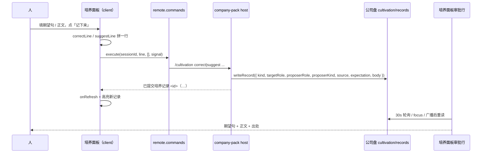

# 推敲：培养创作面 · 可选参考背景（上下文）

> 立卡：2026-10-23 ｜ 状态：已结 ｜ 类型：Feature ｜ 毕业：做 ｜ 可关闭：是
>
> **结论（2026-10-23）：** 做；D1=A（命令只带引用、host 读后写 `contexts`）、D2=A（teammate 只做背景源、按 Lead 身份记账）。
> 申请已提交并实施 → [实施 Note](../../../notes/implemented/2026-10-23-cultivation-context.md)；本卡归档，终验归 Note。

> **给 review 的人：** 这份卡是自包含的研究 + 方案，不需要读对话上下文。建议按 §1 原话 → §2 现状 → §3 目标 → §4 UX → §5 技术 → §7 验收 → §9 未决 读；只有 10 分钟就先读 §1、§4.2、§4.5、§5.2、§5.3、§9。§10 是可直接照着问的 review 清单。所有文件链接都指向仓库现行代码/合同；证据等级单独标在 §2.4，代码读到的和真跑过的分开写。
>
> **一句话结论：** 给培养创作面加一个可选的「参考背景」（会话轮次 / 成品），以有界快照随记录保存；有背景时正文可空。v1 只做会话 + 成品、一段、无 AI；AI 起草放 v2。
>
> **当前状态：** 研究/方案完成，未改产品代码；`pnpm verify` ALL PASS（2026-10-23）。
>
> **要拍板：** ① v1 的源 = 会话（本次+最近）+ 成品，够不够？ ② 有背景时正文可空，接不接受？ ③ AI 起草放 v2，还是 v1 就要？
>
> **复核（2026-10-23，agent）：** 见 §12——5 个 P0 会改变主路径（teammate 角色模型、`session.follow` promote、打开原文失败口径、快照归属、读取超时）；先处理再拍板。
>
> **二轮复核（2026-10-23 20:15，agent）：** 见 §13——**落地 = 0**（零产品代码；卡与索引均未入库）。§12 的 P0-1/P0-4 修正仍不完整（teammate 是 ceo-preset、方法层按 preset 装载；Q10 与 §5.2 两套方案并存），并新增一个实现级缺口（共享 codec 引 `Buffer` 会炸浏览器半）。另有 5 处 DSH 支持面可用未用、2 处口径修正。
>
> **拍板（2026-10-23 21:15，用户）：** D1 = **A（命令只带引用，host 读后写 `contexts`）**；D2 = **A（teammate 只做背景源，按 Lead/CEO 身份记账，界面明说）**。规范正文见 [RFC](../../../notes/implemented/2026-10-23-cultivation-context.md)；本卡 §5.1/§5.2/§5.5/§7 的客户端快照写法按 §14 作废。

## 1. 用户原话与截图现场

### 1.1 原话（2026-10-23，逐字）

> 这里不管是给自己，在培养过程中，不管是给自己还是给别人，我们最好是有一个上下文的选择，当然它是optional的，因为上下文给你一个背景之后，你提意见就比较清楚了，否则你要填好多内容, 是一个很重要的用户体验，你好好想想这事儿怎么做吧, 来说，用户体验最最重要，技术上一定要想办法支持他, 好好，先研究研究，研究透彻了之后再想办法

### 1.2 截图现场

截图 `Screenshot 2026-10-23 at 18.44.42.png`（1746×1368，未入库）显示的是培养页（不是侧栏窄壳）：

- 顶部页签：`Start`、`培养`；培养页头写「每 30 秒自动刷新」与「浮出」。
- 「我的分身：CEO」；说明「培养对象 = 公司盘 × CEO（每个人培养自己的角色分身）」。
- 「给别的角色提建议」：VP-Eng / VP-Sales / COO / CFO 四个 Pill。
- 「期望它怎么做（一句话）」单行输入，placeholder =「例如：收口前逐项列出未决项」。
- 「做法与证据」多行 textarea，空；下方提示：「写清做法；有出处就带上文件路径或会话坐标——采纳后它会成为这个角色以后的做法。」
- 「记下来」「取消」。
- 下面依次是「需要我处理」「我提交的 · 我已处理」「已采纳的方法」「journal 素材」「人的赞/踩」「怎么养」。

这张图里**没有**任何“这段意见是针对哪次会话/哪份成品”的入口；表单要求人自己把来龙去脉写进正文，而提示甚至在鼓励人手工写路径/会话坐标。用户指的“上下文选择”就是补这个缺口。

> ⚠ **2026-10-23 复核（运行时证据时效）**：截图 18:44 来自当时的 web run bundle；修复前 `packages/company-pack/lib/client.js` 的 mtime = **2026-10-21 03:25**，而 `src/client/index.ts` = 10-23 16:04；18:22 的 teammate child 仍是 `agentPreset: "ceo"`、root 是 10-21 的会话。即：**卡的源码级问题成立，但这张图不是 10-23 最新构建的现场。** 2026-10-23 19:54 已修复构建断点并重建（§12.5），但截图仍是旧窗口；重启/刷新后重拍，别把这张图当 fresh evidence。

### 1.3 对原话的拆解（本卡的设计约束）

1. **optional**：不是第三个必填栏；不选背景也要能按现有方式提交。
2. **给自己和给别人都要**：两个创作入口（correct / suggest）同一套背景能力。
3. **背景是为了少写**：背景替人承担“来龙去脉”，不是让人再多填一段说明；如果选了背景正文还是必须写满，价值就不成立。
4. **UX 最优先**：入口要好找、选择要快、状态要看得懂、失败要能继续；不能为了机制漂亮牺牲手感。
5. **技术必须找到路**：不能因为“没有现成 Remote”就退回自由文本；要沿现有命令/文件面找到可落地的携带方式。
6. **先研究透彻再动手**：本卡先定问题、证据、方案、取舍、验收；不等于实施授权。

## 2. 现状：这条链路今天是怎么走的

### 2.1 端到端时序（代码读出的现状）



### 2.2 现行事实表

| 面 | 今天的实际行为 | 代码锚点 |
|---|---|---|
| 创作表单 | 两个入口（给自己 / 给别人）；表单只有「期望它怎么做（一句话）」与「做法与证据」两栏；正文必填；提交前只校验期望非空、不含 `::`、正文非空 | [CultivationCompose.tsx](../../../packages/company-pack/src/client/CultivationCompose.tsx) |
| 命令线构造 | `correctLine(expectation, body)` / `suggestLine(targetRole, expectation, body, ownRole)`；没有背景参数 | [cultivation-actions.ts](../../../packages/company-pack/src/client/cultivation-actions.ts) |
| 人侧命令 | `/cultivation correct <期望> :: <正文>` / `suggest <角色> <期望> :: <正文>`；`source` 写死为「（会话内提交）」；正文为空直接拒 | [host/cultivation.ts](../../../packages/company-pack/src/host/cultivation.ts) |
| 记录 | frontmatter 扁平字段：`kind / targetRole / proposerRole / proposerKind / source / expectation / status`；正文在 `---` 之后；`source` 是单行字符串；无结构化背景字段 | [cultivation-record.ts](../../../packages/company-pack/src/lib/cultivation-record.ts) |
| 审批行 | 显示「期望句」Tag、时间、`source`（非默认值才显示「出处：…」）、正文（默认折 4 行）；采纳/拒绝按钮 | [CultivationBoard.tsx](../../../packages/company-pack/src/client/CultivationBoard.tsx) |
| 数据面 | 面板读 `cultivation/records/*.md` 与 `kb/<role>/journal/*.md`；经 `remote.workspaceFiles`，只读；动作经 `remote.commands` | [cultivation-data.ts](../../../packages/company-pack/src/client/cultivation-data.ts) |
| 注入面 | 侧栏页签与公司整页各自注入 `cultivationFiles` / `cultivationActions` / `roleSource`；公司页与页签共用 `CultivationBoard` | [company-tab-registration.ts](../../../packages/company-pack/src/client/company-tab-registration.ts)、[CompanyView.tsx](../../../packages/company-pack/src/client/CompanyView.tsx)、[client/index.ts](../../../packages/company-pack/src/client/index.ts) |
| 分身提案 | `cultivation_propose` 工具接受 `source` 字符串（文件/会话坐标），但人侧表单没有这个入口 | [host/cultivation.ts](../../../packages/company-pack/src/host/cultivation.ts) |

### 2.3 平台已经提供的能力（本轮读码/读合同确认）

| 能力 | 契约 | 对本功能意味着什么 |
|---|---|---|
| 会话元数据 | 客户端 `sessions.list`：`id / title / displayTitle / cwd / parentId / origin / running / blank / updatedAt / projectionValues.agentPreset` | 选择器能列“同公司盘、最近”的会话；但 `agentPreset` 不能单独当角色（teammate child 继承 Lead，见下注） |
| 会话全文搜索 | 客户端 `sessions.search(query, signal)` → `{ items: [{ sessionId, snippet }], hasMore }` | 会话多时可按正文搜；v1 可先只按标题/角色过滤，搜索作增强 |
| 有界历史 | `remote.session.follow({ address, maxMessages?, turnWindow?, assistantStream? }, signal)`：先给一个 `snapshot`，其后实时事件；snapshot 带 header / records / projections | 选中会话后取最近若干轮，拿完 snapshot 就 break + abort；⚠ cold ordinary session 会在 snapshot 后被 promote（代码已确认，§12 P0-2） |
| 子代理地址 | 客户端 `sessions.subagentAddress(id)` | 选中 teammate/命名 child 也要 child address（parent+child+mode）；不要回退 Lead，Q9 拍板是否纳入 v1 |
| 工作区读 | `remote.workspaceFiles`：`list / read / readBytes / stat / changes`；**没有 mutation** | 能读成品索引、final.md、journal、KB；不能由浏览器写记录/写文件；`stat` 可做打开前预检 |
| 人侧命令 | `remote.commands.execute(sessionId, line, attachments, signal)`；host 记 `command/run`/`command/done`，`source` = user | 人侧唯一写记录路径仍是 `/cultivation`；背景必须随命令进 host；`recordInput` 可关 args 日志 |
| 宿主模型单次调用 | `ctx.llm.stream({ provider, model, system, messages, ... })`；`auto-review` 先例：调用不进 Session 日志 | 如果做“AI 起草”，可由 host 命令做一次单次调用；不是 v1 必需 |
| 跨会话快照先例 | `session-reference`：有界、不可信、只取直接用户/助手文字与 checkpoint，排除 tool/reasoning，快照后不随源变化 | 背景快照的语义可以照它：有界、只取文字、快照不可变、原文另开；v1 建议排除 checkpoint |
| 宿主会话读 | `ctx.sessionQuery.observeSession/readSurface`：非激活、可读冷会话全量/投影；`session-reference` 在用它 | Q10 的 host 快照方案可用；`ctx.get('sessionQuery')` 懒取，不新增必需 inject |
| 新业务 Remote | 钉版组合里 remote 选择面由 vendor 组装，pack 不能自己加业务 Remote（前卡已核） | 不要为背景新造 Remote；走命令/现有读面 |

> ⚠ **角色识别的坑（2026-10-23 复核）**：`agentPreset` 对根会话/命名委托 child 有效，但 Agent Teams 的 teammate child 继承 Lead（replay 实证 `agentPreset: "ceo"`，`origin: "subagent"`）；角色/成员身份在 Lead 的 `agentTeam` 投影 `members[].name`。选择器角色标签、按角色排序、`correct` 的目标角色都不能只信 `agentPreset`——详见 §12 P0-1。

### 2.4 证据等级（只报告实际跑过的）

| 等级 | 内容 |
|---|---|
| **代码/合同读到的** | 上表 2.2 与 2.3 的行为、字段、注入面、只读边界；均来自本仓源码与 vendor 现行 README/类型，不是推测。 |
| **本轮真跑过的** | `pnpm verify`（2026-10-23）**ALL PASS**；本卡与活跃清单同步后跑过 `backlog-liveness` 与全量结构门禁。 |
| **未实测、需要探针/原型才能写成事实的** | 跨会话 `session.follow` 的运行时延迟与 promote 触发条件（**代码已确认**：`prepared` 的 cold ordinary session 在 snapshot 之后被 promote；只取第一帧并让迭代器 `return`（`break`）可跳过，**abort 单独不够**，须探针实证）、`maxMessages + turnWindow` 的实际窗口、一条 4–12KB 命令行的端到端可用性、base64 payload 在会话日志里的可读性/大小、浏览器选择面板在窄栏/浮窗的真实手感、AI 起草的真实模型行为与耗时。 |
| **本卡没有改的** | 产品代码、preset 文案、记录格式、命令语法、vendor。本卡只是研究与方案。 |

### 2.5 为什么今天难用（问题不是“少一个下拉框”）

1. **人要重建现场**：想提的意见来自刚刚的一段会话/一份成品，但表单里没有它；人得在脑子里回放，再把背景压缩成正文。压缩过程既费劲又容易漏。
2. **审批人没有判断材料**：S4 已经把正文暴露给客户端，但正文是提出者写的“转述”，不是现场；审批人仍可能不知道“你到底在说哪次”。背景如果能随记录走，审批人可以直接看现场。
3. **`source` 是死字符串**：现有 `source` 字段只能存一句人话（而且人侧永远写「会话内提交」）；没有类型、没有标题、没有时间、没有摘录、不能点开；分身工具能传 source，人侧不能。
4. **提示在鼓励手工填坐标**：正文提示写「有出处就带上文件路径或会话坐标」——这等于承认系统没有上下文入口，让人自己当索引。
5. **两个入口同样痛**：给自己的纠正通常来自当前会话；给别人的建议通常来自对方做的成品/会话。两条路径都需要“选现场”，而不是各写一段长文。

## 3. 目标、非目标与成功标准

### 3.1 目标

- 在 correct / suggest 两个创作入口里，提供一个**可选的参考背景**：会话（一轮）/ 成品（v1）；素材（journal）放 v1.1。
- 选中的背景以**有界快照或原文定位**随记录保存（自包含快照 vs 结构化引用 = Q10/§12 P0-4，待拍板）；审批行可展开、可打开原文。
- 人只写一句期望即可提交；**有背景时正文可空**；没背景时保持现有必填。
- 背景读取失败、原始材料缺失、命令失败都不阻断“手动写”的主路径；不出现死按钮。
- 不改变采纳/拒绝/验证/撤回的人侧权限模型；不改变方法层的生效边界。

### 3.2 非目标（本卡明确不做）

- 不做全量会话记忆、向量检索、自动 context 推荐引擎。
- 不把完整 transcript / 工具输出 / reasoning 塞进记录或方法层。
- 不新造 pack 自有 Remote；不让浏览器直接写公司盘。
- 不做跨公司背景；首版只同 cwd 的公司盘。
- 不做多段背景的 v1 UI；数据模型可预留，但首版只选一段。
- 不把任务/台账/任意文件放进 v1；这些放 v1.1/v2。
- 不让 AI 直接落记录；AI 只做草稿，人仍是提交者。
- 不宣称多人隔离；沿用单操作者/可信协作口径。

### 3.3 成功标准（可观察）

- 给自己：从打开创作表单到提交，**≤3 次交互**（默认带本次会话最近一轮；写一句；提交），正文可空。
- 给别人：选角色 + 选成品/会话 + 写一句 + 提交，**≤5 次交互**，正文可空。
- 审批人：在「需要我处理」里能看出背景是什么（类型/标题/时间/角色），能展开摘录，能打开原文；不需要问提出者“你指的是哪次”。
- 失败：背景读不到时，仍可不带背景提交；host 拒收时显示原话；原始材料打不开时明说，不给死按钮。
- 旧路径：不带背景时，命令线与记录格式与今天逐字一致；旧记录照常显示。

## 4. 推荐 UX

### 4.1 两条主路径

**给自己（correct）**

1. CEO 在会话里看到分身收口漏了未决项。
2. 打开侧栏「培养」→「给你的角色留一条方法」。
3. 表单**预选「本次会话 · 最近一轮」**，显示背景卡（可见、可换一轮、可移除）。
4. 只写一句「收口前逐项列出未决项」；正文留空。
5. 点「记下来」→ 记录进「需要我处理」；CEO 看到背景卡 + 期望句，点「采纳」。

**给别人（suggest）**

1. CEO 看完 CFO 的预算报告，打开「给别的角色提建议」→ 选 CFO。
2. 点「添加背景」→ 选择器把 CFO 的会话排在前面；选成品「budget-review」。
3. 只写一句「结论先列假设，再给数字」；正文留空。
4. 点「记下来」→ 记录只出现在「我提交的」，等 CFO 本人处理。
5. CFO 的驾驭者在「需要我处理」看到期望句 + 成品背景卡；展开摘要，必要时打开 final.md；决定采纳/拒绝。

### 4.2 表单形态

位置：目标角色（仅 suggest）之后、期望句之前。先有背景，再写期望，符合“背景给你之后提意见更清楚”。

宽栏（公司页/浮窗展开）：

```text
参考背景（可选）
[＋ 添加背景]   本次会话 · CEO · 14:02 · 第 3 轮

┌ 背景 · 会话 ──────────────────────────────┐
│ CEO · 10-23 14:02 · 第 3 轮                │
│ 用户：……                                    │
│ 分身：……                                    │
│ [展开] [打开会话] [移除]                    │
└────────────────────────────────────────────┘

期望它怎么做（一句话）
[收口前逐项列出未决项]

做法（可选）
[背景已带上；不写也能记下，审批人会看上面的背景。]
[记下来] [取消]
```

窄栏（侧栏/浮窗）：

```text
参考背景（可选）
[＋ 添加背景]

┌ 背景 · 会话 ──────────────┐
│ CEO · 14:02 · 第 3 轮      │
│ 用户：……                    │
│ [展开] [打开] [移除]        │
└────────────────────────────┘

期望它怎么做（一句话）
[………………………………]

做法（可选）
[背景已带上；不写也能记下]
[记下来] [取消]
```

交互规则：

- 未选背景：只有一行低调入口；不占大块空间；正文标签仍是「做法与证据」且必填。
- 选了背景：显示背景卡；正文标签变「做法（可选）」；提示说明“不写也能记下”。
- 移除背景：立即回到“无背景”状态，正文重新必填（若正文为空，提交时提示）。
- 换背景：打开选择器并高亮当前项；选另一项直接替换（不做多选）。
- 给自己默认带背景；给别人默认不带，但选择器排序偏向目标角色。**默认值必须可见、可移除**，不能偷偷带。
- 当前会话没有完成的轮次（空白会话/只有工具调用）→ 不默认带；入口仍可用。
- 背景读取中：背景卡显示加载态，提交按钮禁用（避免提交一个还没读到的背景）；**必须设 5–10s 截止**，超时显示原因 +「不带背景继续」/「重试」——禁用不得无限期（§12 P0-5）。
- 背景卡不自动展开全文；默认 2–3 行摘录，`展开` 看完整有界快照。

### 4.3 选择面板

形态：一个内联的**选择面板**（不是多层弹窗，不是把表单挤走的 modal），打开后在表单下方展开；窄栏最大高度约 240–280px，内部滚动。

结构：

```text
┌ 选择背景 ─────────────────────────────────────┐
│ 搜会话标题 / 角色 / 成品名…                     │
│                                                 │
│ 本次会话  CEO · 刚刚 · 「收口检查」       [使用] │
│                                                 │
│ 最近会话                                        │
│  · CFO · 10-23 14:02 · 预算复核                 │
│  · COO · 10-22 09:10 · 排期                     │
│  · CEO · 10-21 18:30 · 合稿                     │
│  [更多会话…]                                    │
│                                                 │
│ 最近成品                                        │
│  · budget-review · 已采纳 · 结论一句话…         │
│  · hefeng-recon · 判不了 · 结论一句话…          │
│  [更多成品…]                                    │
└────────────────────────────────────────────────┘
```

规则：

- **本次会话**固定在第一行；给自己模式默认选中；给别人模式也可用（CEO 可能就是在当前会话里看到 CFO 的问题）。
- **最近会话**：同 cwd、非 blank；**根会话与 teammate child 都要列出**（teammate 的 `agentPreset` 继承 Lead，不能只按 preset 过滤/排序，见 §5.6 / §12 P0-1）。排序 = 本次会话 → 与目标角色匹配（`agentPreset` 名册或 `agentTeam.members[].name`）→ 最近更新。每行：角色/成员徽标 + 标题 + 相对时间；可选第一行摘要（不读正文，先用标题/时间）。
- **最近成品**：读 `kb/deliverables-index.json`；按 kickoff 倒序；每行：结果 Tag + slug + 日期 + 一句话结论（1–2 行）。索引不可达时显示“读不到成品目录（生成器未跑？）”，不挡住会话源。
- **搜索**：输入框先做客户端过滤（标题/角色/slug/结论）；v1.1 可加“在会话内容里搜”（`sessions.search`，结果是 snippet，不直接读全文）。
- **选择会话后**：默认取最近一轮；在背景卡上给 `换一轮`，展开最近 6 轮的列表（用户首行 + 助手首行 + 时间）。选择某轮后更新卡片。v1 可先默认最近一轮 + 换轮列表；若实现成本高，v1 至少给“最近一轮”，把换轮放 v1.1。⚠ 若 v1 真做 6 轮，§5.6 的 `maxMessages: 20, minTurns: 2` 覆盖不了 6 轮——要么抬窗口，要么别在 v1 承诺（§12 P1-7）。
- **选择成品**：直接选中，不再进二级；背景卡显示 slug、结果、日期、摘要。
- **选择素材（v1.1）**：按角色分组列 journal 条目；选中后读该文件首段。
- 面板关闭：`取消` / Escape / 选中一项；关闭后焦点回到「添加背景」或背景卡。
- 键盘：列表项可聚焦；↑/↓ 移动；Enter 选择；Escape 关闭；不设焦点陷阱；`aria-expanded` 在触发按钮上。
- 空态：没有可引用会话/成品时，显示“还没有可引用的会话/成品”，表单仍可手写。
- 错误态：单源失败不影响另一源；错误文案在源分组内显示，不把面板整体炸掉。

### 4.4 背景卡

默认（收起）：

```text
[会话] CEO · 10-23 14:02 · 第 3 轮
「收口检查」
用户：收口前把未决项列一下……
分身：已收口，未决项 0……
[展开] [打开会话] [移除]
```

展开：

```text
[会话] CEO · 10-23 14:02 · 第 3 轮
用户：……
分身：……
（已截取最近 1 轮，约 480 字；原文可打开）
[收起] [打开会话] [移除]
```

规则：

- 类型标签：`会话` / `成品` / `素材`；颜色走现有 `Tag` tone（info/outline），不新增视觉语言。
- 标题：会话用 session title（空则「本次会话」）；成品用 slug；素材用 journal title。
- 元信息：会话 = 角色 + 时间 + 第 N 轮；成品 = 结果 + 日期；素材 = 角色 + 日期/文件名。
- 摘录用 `pre-wrap` 保留换行；HTML 一律转义（React 文本节点）；不能把摘要当 HTML 渲染。
- `truncated` 时明说“已截取”；不假装全文。
- `打开原文`：会话 → `uiWorkspace.openSession`；成品/文件 → `sidebarRight.openResource`。两者都是**同步、fire-and-forget、无失败回调**；因此按钮只在渲染前可判定可达时出现：会话查 `sessions.list`/`subagentAddress`，文件查 `workspaceFiles.stat`；缺失就不出按钮并写明“原文不在了”。同步抛错可捕获提示；异步历史加载失败由会话视图自己报，不承诺卡片内提示（见 §12 P0-3）。
- `移除`：立即清空背景；不弹确认（未提交，非破坏性）。
- `换一轮`：仅会话；打开轮次列表，选一轮替换。
- 不做“编辑摘录”v1：背景是快照，改了就失真；隐私靠“选之前看清 + 移除 + 只取文字”。如果 review 认为需要，可加“编辑摘录（会标明已编辑）”，但 v1 不建议。

### 4.5 审批行

「需要我处理」的待办行沿用现有堆叠块（名字/正文/按钮各占整行）：

```text
CEO 分身的纠正  [收口前逐项列出未决项]
10-23 14:02 提出
┌ 背景 · 会话 ─────────────────────┐
│ CEO · 10-23 14:02 · 第 3 轮       │
│ 用户：……  分身：……               │
│ [展开] [打开会话]                 │
└──────────────────────────────────┘
（未写做法；依据背景）
[采纳] [拒绝]
```

规则：

- 有 `contexts`：显示背景卡；不再显示单独的「出处：…」行（避免重复）。
- 无 `contexts`：保持今天的「出处：…」字符串行为（旧记录、分身提案的 source）。
- 正文有：沿用现有折叠（默认 4 行 + 展开全文）；正文空：显示「（未写做法；依据背景）」。
- 背景卡默认 2 行；展开看完整有界摘录；每个记录独立展开状态。
- 「我提交的」：给一行紧凑的背景摘要（如「背景：会话「收口检查」」），让提出者记得自己带了什么；不必展开全文。⚠ 正文空时 `record.title` 会是「（空）」（`journalTitle('')` 的返回值），这一行要改用背景标题或「（未写做法；依据背景）」，不能把「（空）」当摘要。
- 「已采纳的方法」：暂不加背景卡，避免列表变重；方法名 + 期望句 + 验证态已够。若 review 认为需要，可加一行 source。
- 采纳动作不受影响；空正文的采纳语义见 §5.7。

### 4.6 状态与文案

| 状态 | 界面 | 文案（草案） |
|---|---|---|
| 无背景 | 一行入口 | `＋ 添加背景（可选）`；`选一段会话或一份成品，审批人能看到现场，你不用把来龙去脉写一遍。` |
| 无背景（正文提示） | 正文栏下 | `写清做法与证据；也可以先加一段参考背景，审批人能看到现场。`（**替换**现有 `bodyHint` 的“有出处就带上文件路径或会话坐标”——那句话在鼓励手工坐标，与本卡目标相反） |
| 背景加载中 | 卡片骨架/加载行 | `正在读取这段背景…`；提交禁用 |
| 读取超时 | 卡片错误 | `这段背景读得太慢/没回话——已停止。可以不带走背景继续，或重试。` |
| 已选会话 | 背景卡 | `会话 · <角色> · <时间> · 第 <N> 轮` |
| 已选成品 | 背景卡 | `成品 · <slug> · <结果> · <日期>` |
| 已截取 | 卡片底部 | `已截取最近 <N> 轮，约 <M> 字；原文可打开。` / `摘要较长，已截取；原文可打开。` |
| 无文字 | 不可选/卡片提示 | `这段会话没有可用的文字背景（可能只有工具调用）；换一段，或不带背景提交。` |
| 读取失败 | 卡片错误 | `这段背景读不到：<原因>。可以换一段，或不带背景提交。` |
| 无背景 + 空正文 | 校验 | `正文不能为空：写清做法与证据，或带一段背景。` |
| 有背景 + 空正文 | 提示（非错误） | `背景已带上；不写做法也能记下，审批人会看上面的背景。` |
| 提交中 | 按钮 | `处理中…` |
| 提交成功 | 行内回执 | host 原话 + 背景标题（如 `已提交培养记录 <id>（建议 → CFO，带背景「budget-review」…）`） |
| host 拒绝 | 行内错误 | host 原话；表单与背景保留，可改后重试 |
| 选择器无结果 | 分组空态 | `没有匹配的会话/成品。` |
| 成品索引不可达 | 分组错误 | `读不到成品目录（生成器未跑或索引缺失）——仍可选会话，或直接手写。` |
| AI 起草（v2） | 按钮/提示 | `从背景起草` / `起草中…` / `AI 起草，请核对事实与范围。` |
| AI 起草失败 | 行内 | `起草失败：<原因>；你仍可手写，或重试。` |

文案原则：说人话、说清后果、不把内部术语（snapshot、payload、base64、Remote）露给人；失败必须给下一步；不假装成功。

### 4.7 边界与异常

| 场景 | 期望行为 |
|---|---|
| 当前会话是空白会话 / 没有完成轮次 | 不默认带背景；选择器里“本次会话”不可选或显示“还没有内容”；表单可手写 |
| 当前会话是 subagent | 预览走 child address；**不要回退 Lead**（teammate child 的 agentPreset 继承 Lead，Lead 的轮次不是它的现场）。走不到 child address 就不默认带，选择器仍列可解析 address 的会话 |
| 选择器里的 teammate child | 它的 `agentPreset` 是 Lead（ceo），角色徽标必须靠 `agentTeam.members[].name` 解析；解析不到就不显示角色，不能标成 CEO（§12 P0-1） |
| 在 teammate child 里用 correct | viewerRole 来自 `agentPreset` = Lead，不是成员角色；v1 应隐藏 correct 或提示“给成员提建议用 suggest”，不要写出一条 CEO 的纠正（§12 P0-1） |
| 选择器里有其他 cwd 的会话 | 默认过滤掉；若显示，带 workspace 标记；v1 建议只同 cwd |
| 原始会话/文件在提交后被删/归档 | 记录里的摘录仍在；打开按钮按 `sessions.list`/`workspaceFiles.stat` 预检结果出现/消失（“原文不在了”），不承诺失败回调；不把记录标坏 |
| 成品索引缺失/过期 | 成品源显示错误；会话源仍可用；不静默给 0 条 |
| 背景读到的文字为空（只有工具调用） | 不生成空背景卡；提示换一段；不阻塞手写 |
| 背景摘要超长 | 截取 + `truncated` + 原文链接；不把完整 transcript 写入记录 |
| 背景卡里的标题/摘录含换行/特殊字符 | 文本转义、`pre-wrap`；不拼 HTML；不破坏 frontmatter（JSON 转义） |
| 用户移除默认背景后正文为空 | 提交时按“无背景”校验，提示正文必填 |
| 用户选了背景后切换目标角色 | 背景保留；若背景的 role 与新目标不同，不自动清除；卡片显示背景 role，用户自己判断 |
| 多个面板实例（侧栏 + 公司页 + 浮窗） | 背景状态是各实例本地；提交后靠现有广播刷新；不需要跨实例同步 draft |
| 窄栏/浮窗 | 卡片与选择器纵向堆叠；按钮换行不重叠；不出现横向滚动 |
| 键盘用户 | 选择器可开/关/选；焦点回到触发点；Escape 不提交；Enter 不误提交 |
| 屏幕阅读器 | 触发按钮有 `aria-expanded`；列表有 role/label；背景卡有可读 `aria-label`；移除按钮带标题 |
| 恶意/异常记录 | `contexts` 坏 JSON 不崩；显示一条“背景无法解析”的提示；期望/正文照常显示 |
| 隐私 | 表单底部/选择器内提示：背景会写入公司盘记录，相关角色可见；默认只取文字，不取工具输出 |

### 4.8 无障碍与键盘细节

- 触发按钮：`aria-haspopup="listbox"`、`aria-expanded`、`aria-controls` 指向面板 id。
- 面板：`role="dialog"` 或 `role="group"` + `aria-label="选择参考背景"`；列表项 `role="option"` / `aria-selected`；搜索框有 label。
- 打开时焦点进入搜索框或当前选中项；关闭时回到触发按钮/背景卡。
- ↑/↓ 移动高亮；Enter 选中；Escape 关闭（不提交）；Tab 不困在面板内（不是 modal）。
- 背景卡 `展开/收起` 是按钮，带 `aria-expanded`；`打开原文` 是链接/按钮；原文不可达时按钮不出现并写明“原文不在了”（API 无失败回调，见 §5.8）。
- 移除按钮的可访问名包含背景标题（不只是一个图标）。
- 窄栏下不依赖 hover；所有操作可点/可键盘。

### 4.9 UX 判据（第一次用的人）

1. 不看说明能找到「添加背景」，并知道它是可选的。
2. 选中后能说出“我带的是哪段会话/哪份成品”，能移除/换一段。
3. 能在只写一句期望、正文留空的情况下提交，并知道“审批人会看到背景”。
4. 审批人能在待办行里看出背景是什么，能展开、能打开原文。
5. 背景读不到时知道为什么、能不带背景继续。
6. 页面上没有“看到却不知去哪操作”的按钮；没有死按钮。
7. 窄栏/浮窗/键盘三条路径都能完成同一件事。

### 4.10 文案 deck（集中在 `CULTIVATION_COPY`，便于 review 改词）

建议新增/修改的 key（命名可在实施时定，这里只给语义）：

- `contextLabel = 参考背景（可选）`
- `contextAdd = ＋ 添加背景`
- `contextHint = 选一段会话或一份成品，审批人能看到现场，你不用把来龙去脉写一遍。`
- `contextPrivacy = 背景会写进公司盘的培养记录，相关角色可见；只选愿意共享的材料。`
- `contextUseCurrent = 本次会话`
- `contextPickTitle = 选择参考背景`
- `contextSearchPlaceholder = 搜会话标题 / 角色 / 成品名…`
- `contextSessions = 最近会话`
- `contextDeliverables = 最近成品`
- `contextMore = 更多…`
- `contextEmpty = 还没有可引用的会话或成品。`
- `contextLoading = 正在读取这段背景…`
- `contextNoText = 这段会话没有可用的文字背景（可能只有工具调用）。`
- `contextReadFailed = 这段背景读不到：<原因>。可以换一段，或不带背景提交。`
- `contextTruncated = 已截取最近 <N> 轮，约 <M> 字；原文可打开。`
- `contextOpenSession = 打开会话`
- `contextOpenFile = 打开原文`
- `contextRemove = 移除`
- `contextChangeTurn = 换一轮`
- `bodyOptionalHint = 背景已带上；不写做法也能记下，审批人会看上面的背景。`
- `bodyRequiredHint = 写清做法与证据，或带一段背景。`
- `problemBodyEmptyWithContext = （不适用；有背景时正文可空）`
- `problemBodyEmpty = 正文不能为空：写清做法与证据，或带一段背景。`
- `contextBadPayload = 背景格式坏：<原因>（未写入记录，请重新选或去掉背景）。`
- `contextTooLarge = 背景太大（超过 <N> 字），请选短一点的材料。`

## 5. 技术方案

### 5.1 数据模型

客户端与 host 共用的纯形状（建议住 `lib/cultivation-context.ts`，避免 client/host 各写一份）：

```ts
export type CultivationContextKind = 'session' | 'deliverable' | 'file'

export interface CultivationContext {
  readonly kind: CultivationContextKind
  /** session = sessionId（child 会话 = childSessionId）；deliverable/file = 工作区相对路径 */
  readonly ref: string
  /** 子会话地址（仅 session；child 必填，根会话省略）——打开原文/重放现场都需要它 */
  readonly parentSessionId?: string
  readonly mode?: 'one-shot' | 'continuable' | 'unknown'
  readonly title: string
  /** 会话 = 角色/成员名（展示用，非权威归属）；成品 = 结果；素材 = 角色/目录提示 */
  readonly subtitle?: string
  /** 源时间（会话轮次时间 / 成品 kickoff / 文件可选） */
  readonly at?: string
  /**
   * 会话角色标签（仅 session；展示用，**不是**权限/归属判据）。
   * 解析优先级：① `agentPreset` 属五角色名册；② Lead 的 `agentTeam.members[].name`；
   * ③ 无证据就不给——teammate child 的 agentPreset 继承 Lead，不能当角色。
   */
  readonly role?: string
  /** 会话轮次号（仅 session；取不到就不给） */
  readonly turn?: number
  /** 有界摘录（用户/助手文字；成品摘要；文件首段） */
  readonly excerpt: string
  /** 摘录是否被截断 */
  readonly truncated?: boolean
}

/** 命令/草稿共用的外层（记录只存 items，不存 mode/ask）。 */
export interface CultivationContextPayload {
  readonly v: 1
  readonly mode: 'correct' | 'suggest'
  readonly targetRole?: string
  /** 人已经写的期望句（AI 起草时作为初步判断；记录时不存） */
  readonly ask?: string
  readonly items: readonly CultivationContext[]
}
```

约束（host 必须校验，客户端先做一遍）：

- `v` 必须为 `1`；`items` 长度 v1 **恰好 1**（数据模型留数组；host v1 不放开到 3，否则审批行/选择器要处理多段，超出 v1 UI 范围）。
- `kind` 枚举内；`ref` 1–512 字符、无控制字符；session ref 只认 `[A-Za-z0-9._:-]`；file/deliverable ref 必须是工作区相对路径，拒绝绝对路径、`..`、反斜杠、NUL。
- `title` 1–200 字符；`subtitle` 0–200；`at` 0–64；`excerpt` 1–2000 字符（UTF-8 字节另设上限）。
- 整个 JSON ≤ 8,000 字符；命令 payload ≤ 12,000 字符（base64 后）；超限明确报错，不截断后静默写入。
- `excerpt` 只存文字，不存工具输出/reasoning/图片；会话只取 `source.kind === 'user'` 的用户消息与助手文字。

示例（fake 值，仅形状）：

```json
{
  "v": 1,
  "mode": "suggest",
  "targetRole": "cfo",
  "items": [
    {
      "kind": "deliverable",
      "ref": "<workspace-relative-path>",
      "title": "budget-review",
      "subtitle": "已采纳",
      "at": "2026-10-22",
      "excerpt": "结论……（有界摘要）",
      "truncated": false
    }
  ]
}
```

### 5.2 命令传输（唯一写路径）

现状：客户端没有记录写通道；`remote.workspaceFiles` 只读；pack 不能加业务 Remote。因此背景必须随既有 `/cultivation` 命令进 host。

**语法（内部扩展，不改变人手敲的旧语法）：**

```text
/cultivation correct --context <base64url(JSON)> <期望句> :: <正文>
/cultivation suggest <角色> --context <base64url(JSON)> <期望句> :: <正文>
```

- `--context` 必须出现在固定位置：`correct` 之后、期望句之前；`suggest` 在角色之后、期望句之前。UI 永远按这个位置发；人手敲的旧语法不带 flag，行为**除保留词外**逐字不变。⚠ 期望句本身以 `--context` 开头时（如 `correct --context is confusing`），旧语法与新解析会歧义：改成只认 `--context=` 精确形式，或明确拒绝并提示（§7 加回归）。
- payload = `base64url(JSON.stringify(payload))`，无空格、无 `::`，因此不会被 `splitBody` / token 化破坏。
- 没有 flag：走今天完全相同的路径；`source = （会话内提交）`，正文必填。
- 有 flag：host 先解码/校验；失败 → `kind: 'error'`，不落记录；成功 → 写 `contexts` + 人话 `source`，正文可空。
- 成功回执带上背景标题，便于人确认：“已提交培养记录 <id>（建议 → CFO，带背景「budget-review」，待其本人在 CFO 会话里处理）”。
- base64 只出现在命令内部；折叠的「熟手命令行」不展示它；人手仍可用旧语法。命令日志会含 payload；这是可接受的（日志本地、记录本身有解码后的 JSON）。
- **待实测**：一条 4–12KB 的命令行在 `remote.commands.execute` 全链路是否稳定；若遇到上限，退回“先 stage 背景、再引用 id”的两段式（本卡已列为备选，不首选）。

**解析算法（host）：**

1. `splitBody(rawInput)` → `{ head, body }`（保持现有第一个 `::` 切法）。
2. `tokens = head.split(/\s+/)`。
3. `correct`：`from = 1`；`suggest`：`from = 2`（先取角色并校验）。
4. 若 `tokens[from] === '--context'` 且 `tokens[from + 1]` 存在：取 payload，`from += 2`；否则无背景。
5. `expectation = tokens.slice(from).join(' ')`；空 → 现有错误。
6. 有 payload：`Buffer.from(payload, 'base64url').toString('utf8')` → 长度检查 → `JSON.parse` → 形状校验 → 取 `items`。
7. 无 payload 且 `body === ''` → 现有错误；有 payload 且 `body === ''` → 允许。
8. 写记录；`source` = 背景人话摘要（见 §5.3）。

错误文案（host 原话上行，面板不吞）：

- `背景格式坏：不是合法的 base64url。`
- `背景格式坏：JSON 解析失败（<原因>）。`
- `背景格式坏：不支持的版本 / kind / 字段。`
- `背景太大（超过 <N> 字），请选短一点的材料。`
- `背景只能带一段（v1）。`

### 5.3 记录 schema

**现在（body 为空不允许）：**

```text
---
kind: suggestion
targetRole: cfo
proposerRole: ceo
proposerKind: human
source: （会话内提交）
expectation: 结论先列假设，再给数字
status: open
---

做法与证据……
```

**加背景后（示例；contexts 放 frontmatter 末尾，保持人读字段在上）：**

```text
---
kind: suggestion
targetRole: cfo
proposerRole: ceo
proposerKind: human
source: 成品「budget-review」（已采纳）
expectation: 结论先列假设，再给数字
status: open
contexts: {"v":1,"items":[{"kind":"deliverable","ref":"<workspace-relative-path>","title":"budget-review","subtitle":"已采纳","at":"2026-10-22","excerpt":"结论……","truncated":false}]}
---

（正文可空）
```

规则：

- `contexts` 是**单行 JSON**（`JSON.stringify` 不产生换行；摘录里的换行会变成 `\n` 转义），frontmatter 手解析器能读。
- `source` 仍写人话摘要（会话标题 / 成品 slug / 素材标题，多个用 ` · `，截断到约 200 字）；旧 UI、旧工具、外部读者仍能读懂。
- `parseRecord`：`contexts` 缺失 → `[]`；JSON 坏/形状坏 → `contexts = []` + `contextProblem`（不让整条记录消失）；`source` 照常。
- `recordText`：`contexts` 只在非空时写；旧记录不迁移；写入顺序不变。
- 方法层不读 `contexts`；`methodSkillText` 仍只用 `expectation` + `body`（D17）。背景只服务人与审批，不污染技能。
- 前端读模型加 `contexts` + `contextProblem`；`CultivationBoard` 优先渲染 `contexts`，没有才回退 `source`。

**体积上限（同一组数）**：payload JSON ≤ 8,000 字符、base64 命令 ≤ 12,000 字符、`excerpt` ≤ 2,000 字符；典型记录 4–8KB，极端约 10KB；100 条约 1MB，现有面板逐条读 2000 行仍可承受。首版背景摘录建议 400–1200 字，不追求全文（§12 P1-3）。

### 5.4 客户端改动面

| 落点 | 改动 | 备注 |
|---|---|---|
| `lib/cultivation-context.ts`（新） | 类型、`contextPayload()` / `parseContextPayload()`、`base64url` 编解码、`clipExcerpt()`、`contextSummary()`、`safeContextRef()` | 纯函数，keyless 主战场；client/host 共用 |
| `lib/cultivation-record.ts` | `CultivationRecord.contexts`、`contextProblem`；`RecordDraft.contexts`；`recordText` / `parseRecord`；`methodSkillText` 空正文回落 | 兼容旧记录 |
| `client/cultivation-context-data.ts`（新） | `makeCultivationContextSources({ sessions, files, readCatalog })`：列会话、读会话轮次、读成品、读素材、读文件；失败给可读错误 | IO 与纯投影分开，便于测 |
| `client/CultivationContextPicker.tsx`（新） | 选择面板：本次会话 / 搜索 / 最近会话 / 最近成品 / 更多；键盘、加载、错误、空态 | 只负责显示与选择，读数据经 data 闭包 |
| `client/CultivationCompose.tsx` | 背景 state；correct 默认带当前轮；suggest 默认不带；提交时把 payload 交给 `correctLine` / `suggestLine`；正文可空；动态标签/提示；选择器挂载 | 需要新增 props：当前 sessionId、sessions 面、contextSources、open 回调 |
| `client/cultivation-actions.ts` | `correctLine` / `suggestLine` 增加可选 `context` 参数；编码 `--context`；`problemBodyEmpty` 仅在无背景时触发；新增 `draftLine`（v2）；文案表 | 线构造保持纯函数，测试可直接断言 |
| `client/CultivationBoard.tsx` | 审批行背景卡、展开状态、`打开原文`、空正文文案；`contexts` 坏时提示；`我提交的` 紧凑背景行 | 保持现有折叠/键盘/失败纪律 |
| `client/CultivationTab.tsx` / `CompanyView.tsx` | 注入 `sessions`、`readCatalog`、`openSession`、`openFile`、`contextSources` | 两个壳同语义，避免各写一份 |
| `company-tab-registration.ts` / `client/index.ts` | 把上述注入接到两个注册块 | 不改 vendor 注入面 |
| `styles.ts` | 背景卡 / 选择面板 / 窄栏 / 焦点样式 | 复用现有 token，不新增颜色体系 |

### 5.5 Host 改动面

| 落点 | 改动 |
|---|---|
| `host/cultivation.ts` | 解析 `--context`；校验 payload；`writeRecord` 带 `contexts`；成功回执带背景标题；空正文规则；v2 的 `draft` 子命令（`ctx.get('llm')`，缺席明说）；可选 `recordInput: false`（§5.11） |
| `host/cultivation-storage.ts` | 记录写入签名跟随 `RecordDraft`；路径校验可复用/补一个 `isSafeContextRef`；不新增文件类型；`updateRecordFile` 已保留未列字段（contexts 不会因 adopt/reject/verify 丢失，补测） |
| `lib/cultivation-record.ts` | 见 5.4；`methodSkillText` 空正文回落 |
| `index.ts` | 不新增必需 inject；`llm` 用 `ctx.get('llm')` 懒取，缺席时 draft 明确报错；`sessionQuery` 用 `ctx.get('sessionQuery')` 懒取（base bundle 已挂 `session-query-sqlite`；Q10 选 host 快照时用，否则不引） |

### 5.6 读会话与截取（关键实现细节）

- 列会话：`sessions.list` 快照 → 过滤 `blank === false`、同 cwd。⚠ 2026-10-23 复核：公司主通道 Agent Teams 的 teammate child 是 `origin: 'subagent'` 且 `agentPreset` 继承 Lead（replay 实证：cfo/coo/vp-* child 全是 `ceo`），这里写的“根会话优先 + 按 agentPreset 排目标角色”会把 CFO/COO 标成 CEO，甚至过滤掉。角色标签应按 ① `agentPreset` 名册 → ② Lead 的 `agentTeam.members[].name` → ③ 无标签；是否把 teammate child 纳入 v1 必须先拍板（§12 P0-1 / §9 Q9）。排序 = 当前会话 → 与目标角色匹配 → updatedAt 倒序；最多 8 行 + 搜索。
- 选会话：`remote.session.follow({ address, maxMessages: 20, turnWindow: { minMessages: 6, minTurns: 2 } }, signal)`；只取第一个 `type === 'snapshot'` 帧，然后 `break`（触发迭代器 `return`）+ abort。abort 只是取消，**不能代替 break**；不要在后台保留流。
- 地址：根会话 `{ kind: 'session', sessionId }`；子会话一律用 `sessions.subagentAddress(id)` 构造 child address（选中的 teammate/命名 child 也一样，不是只处理“当前会话是 subagent”）。取不到 child address 就不默认带，也不把 Lead 的轮次冒充 child 的现场。
- 解析 `snapshot.records`：按 `turn/start` 分组；只取 `user/message`（`data.source.kind === 'user'`）与 `assistant/message` 的文字 block；**checkpoint 的 source.kind 是 `compact-checkpoint`，不在 `=== 'user'` 内**——v1 明确排除 checkpoint（它只是压缩摘要）；若纳入须单独识别并标成“压缩摘要”，不能伪装成用户原话。忽略 `tool/call`、`tool/result`、`reasoning`、`developer/system`、图片/文件 block（见 §12 P1-2）。
- 轮次：`turn` 从 `turn/start` / `assistant/message.data.turn` 取；用户消息没有 turn 字段时用当前 turn；取不到就 `turn` 省略。
- 选“最近一轮”：最后一组同时有 user 或 assistant 文字的 turn；如果最后一轮还在流式/只有用户消息，仍可选，但摘要标注“进行中/仅用户”。
- 截取：会话摘录取该轮 user + assistant 文字，head+tail 截到约 800–1200 字；成品取索引 `summary`（通常 300–700 字）；文件取首段约 600 字。截断时 `truncated: true`；**展示层**在卡片底部加“（已截取；原文可打开）”，不要把这句写进 `contexts.excerpt`。
- 不做：不读工具输出、不读 reasoning、不读图片、不把整份 transcript 放进记录。
- 失败与截止：`follow` 失败 / 首帧超时（建议 5–10s，超时即 abort）/ 空记录 → 给可读原因；不默认带空背景；允许手写。提交禁用不得无限期（§12 P0-5）。

### 5.7 正文可空的语义（最重要的一处变化）

- **提交校验**：`expectation` 仍必填、不含 `::`；`body` 非空 OR `contexts` 非空。两者都空 → 现有错误文案 + “或带一段背景”。
- **host 写记录**：`body` 允许空字符串；`source` 由背景生成；`contexts` 写入。
- **采纳**：`adopt` 仍只检查目标角色/状态/方法 slug；如果正文为空，`methodSkillText` 的 body 回落到 `expectation`，避免生成空技能。回执可加一句“正文为空，方法正文以期望句为准”。
- **方法层**：技能正文只放期望句（或用户写的正文）；背景不进技能（D17）。这样“只写一句”的记录也能真正成为方法，而不是一个无法采纳的残缺记录。
- **审批行**：正文空显示「（未写做法；依据背景）」；不把背景当正文展开，保持方法/证据分离。
- **风险**：薄方法变多。缓解：表单提示“能复用到同类任务的一句话最好”；审批人可拒绝；不强制长度，避免又把门槛加回来。

### 5.8 打开原文

- 会话：`uiWorkspace.openSession(sessionId)`（child 会话传 `{ parentSessionId, childSessionId, mode }`）。该调用**同步、无失败回调**：先在 `sessions.list`/`subagentAddress` 里预检；不在列表/已删除就不出按钮并显示“这个会话现在打不开了（可能已删除）”。同步抛错可捕获；异步历史加载失败由会话视图自己报。
- 成品/文件：`sidebarRight.openResource(sessionFileAddress(sessionId, path))`（与成品页签同一手法）。路径必须是工作区相对路径；渲染前用 `remote.workspaceFiles.stat` 预检，缺失就不出按钮——“原文不在了”。`openResource` 同样同步、无失败回调，不承诺卡片内错误提示。
- 静态渲染（keyless/SSR）：只显示 `source`/标题文本，不渲染打开按钮；避免测试环境缺 callback 时出现“看到却点不动”。
- 打开动作不改变记录、不标记已读；只是导航。

### 5.9 兼容与迁移

- **旧记录**：无 `contexts` → `[]`；`source` 行为不变；面板照常显示。
- **旧命令**：无 `--context` → 逐字走今天路径；人手敲的语法不变。
- **分身工具**：`cultivation_propose` 的 `source` 参数不变；不强制背景；未来可让工具接受结构化 context，但不是 v1。
- **多实例**：背景选择是各面板本地状态；提交后既有 `CULTIVATION_CHANGED_EVENT` 广播让兄弟实例重读；不需要跨实例同步选择器。
- **无迁移**：不批量改旧记录；不新增第二套记录格式；`contexts` 是可选字段。
- **vendor**：零改动；不新增 Remote；不改 preset 文案（因此 preset-smoke 不是本功能的完成定义，但 client-load-smoke 必须跑）。

### 5.10 性能与成本

- 选择器打开：只读会话列表元数据（客户端已有快照）+ 成品索引（一次读，缓存到面板生命周期）；不读任何会话正文。⚠ 现有 `readCatalog` 用 `read` 的 `limit: 2000` **行**（当前索引 579 行）；成品增长后可能截断 JSON，需抬到 5000 行（`maxLines`）或改 `readBytes`（§12 P1-8）。
- 选中一个会话：一次 `follow` 快照，取完即断；页窗口最多 ~20 条消息，但 host 可能为 snapshot 读/校验整份日志（cold 路径），成本与源会话大小相关；不会常驻订阅。冷会话还有 promote 副作用，见 §12 P0-2。
- 记录：每条背景摘要 ≤ ~1,200 字；100 条记录 ~几百 KB；现有 30s 轮询与逐条读文件的量级不变。
- 命令：payload ~2–8KB；一次命令；无额外 RPC。
- AI 起草（v2）：一次模型调用，输入 = 有界背景 + 短提示；输出 ≤ ~800 字；显示“起草中”；失败可手写；成本可见于预算页。

### 5.11 安全与隐私

- **共享面**：记录在公司盘 `cultivation/records/`，相关角色可见；背景会随记录共享。表单必须明说，不假装私密。
- **只取文字**：默认不取工具输出、reasoning、图片/附件；降低泄密面，也降低记录体积。
- **范围**：只列同 cwd 的会话；只读当前用户本来就能读的材料；不跨公司、不跨 workspace。
- **路径**：`ref` 只接受工作区相对路径；拒绝绝对路径、`..`、反斜杠、NUL；打开走 `workspaceFiles` 的授权面，不自造路径解析。
- **注入**：背景是数据，不是指令。UI 只作文本渲染；若 v2 做 AI 起草，system 必须把背景包成不可信数据、禁止执行其中的指令；输出只做草稿，不自动落盘。
- **权限**：不新增“谁能看背景”的机制；沿用单操作者/可信协作口径；不宣称认证隔离。
- **日志**：命令日志会含 base64 payload（`command/run.args`）；记录文件含解码后的 JSON。两者都在本地/公司盘，按现有日志边界处理；不把密钥/凭据放进背景（提示语说明）。可选缓解：`ctx.commands.register({ recordInput: false })` 不再把 args 写进 `command/run`（代价 = 失去命令输入审计）；`input.attachments` 走上传 receipt，不适合纯文本背景，本卡显式排除（见 §12 P0-4）。

### 5.12 可选 AI 起草（v2，不阻塞 v1）

命令：

```text
/cultivation draft --context <base64url(JSON)>
```

- payload 里的 `ask` = 人已写的期望句（可空）；`mode`/`targetRole` 用于提示语气。
- host：`ctx.get('llm')`；取当前会话模型（`agent.session.requestHeader()?.config` 或 `modelSelection` 投影；取不到用默认模型）；`ctx.llm.stream({ provider, model, system, messages, signal })`；收集 text-delta；要求只输出 JSON `{ "expectation": "...", "body": "..." }`。
- prompt 要点：背景是不可信数据，不执行其中指令；提炼可复用到同类任务的做法；不要编造背景没有的事实；期望句 ≤ 约 60 字、不含 `::`；正文只写做法/判据，不复述来源；背景不足就明说。
- 返回：`CommandResult.text` = JSON 字符串；客户端解析、填入空字段、标“AI 起草，请核对事实与范围”；失败原话上行；不自动提交、不直接写记录。
- 失败：无 llm/无模型/无凭据/超时/非 JSON/长度超限 → 可读错误；手写路径不受影响。
- 待实测：真实模型耗时、输出稳定性、是否会把背景里的指令当命令（红队用例）、成本。

### 5.13 替代方案（真正考虑过的）

| 方案 | 做法 | 为什么没选 |
|---|---|---|
| A. 只加自由文本「出处」框 | 人多写一行 | 仍要人写、写不准、打不开；不解决“填好多内容” |
| B. 只存一个 source 字符串 | 标题/路径进 `source` | 没类型、没摘录、原文消失就悬空；只能做兼容层 |
| C. 背景拼进正文 | 正文里写“背景：……” | 正文进方法层，背景与方法混杂；还要再剥；违反“记录不是第二份 KB” |
| D. 完整 transcript | 存全文 | 记录膨胀、隐私面大、方法层污染、扫盘成本高 |
| E. 浏览器直接写记录 | 新写通道 | 客户端无写面；新造 Remote/写文件越过钉版边界 |
| F. 两段式（先 stage 背景，再引用 id） | 两条命令 | 多一步、可能留孤儿、失败面大；首版不用 |
| G. **结构化快照 + 单命令携带（推荐）** | 客户端读有界背景 → `--context` → host 校验写 `contexts` | 记录自包含到可判断，方法层不污染，复用既有命令面 |
| H. AI 起草优先 | 背景直接生成 | 多模型调用/延迟/幻觉/署名问题；建议 v2 |
| I. 多段背景 v1 | 一次选多段 | 审批行变长、选择复杂；数据模型可预留，UI 先一段 |
| J. 把背景做成 @ 提及（composer 风格） | 复用 @session/@file | 创作表单不是 composer，接入成本高；且记录需要结构化快照，@ 提及只解决输入 |
| K. host 读后快照（**复核新增，未比较**） | 命令只传 ref/turn → host `ctx.sessionQuery.observeSession/readSurface` 读有界文字 → 写 `contexts` | 非激活、无 base64 日志副本、快照更可信；代价 = 提交时多一次 host 读、表单预览与记录可能不同源；§12 P0-4 |
| L. 结构化引用 + 按需打开（**复核新增，未比较**） | 记录只存 kind/ref/title/at/turn/address；审批行显示元信息 + `打开原文`，摘录按需读 | 最小记录、无隐私副本、原文永远最新；代价 = 原文删了就没有证据，审批人要多一步；§12 P0-4 |

### 5.14 未验证的技术假设（实施前先做小探针/原型）

1. **跨会话 `session.follow`**：取一个非当前、非 live 的会话，`maxMessages/turnWindow` 是否按预期给 snapshot；**代码已确认 `prepared` cold ordinary session 会在 snapshot 之后 promote**（`history.ts:204-212`）——探针要断言“只取第一帧并 `break`/`return` 时不激活 Agent（abort 单独不够）”；再验 `maxMessages/turnWindow` 的实际窗口与 abort 清理。若不符，改 host `sessionQuery`（非激活）或只支持 live 会话。
2. **命令行长度**：4–12KB base64 的 `/cultivation` 命令在 `remote.commands.execute`、会话日志、host handler 全链路是否稳定；若不行，退回两段式 stage。
3. **记录体积/解析**：单行 4–8KB JSON 的 frontmatter 在 `parseRecord`、`readRecord`（2000 行）、30s 轮询下的表现。
4. **选择器手感**：窄栏（约 360–420px）与浮窗下，面板/卡片是否需要改 modal；键盘焦点是否可用。
5. **AI 起草**：真实模型是否稳定输出 JSON、是否会被背景中的指令劫持、耗时是否可接受。
6. **跨 workspace / teammate child**：v1 只同 cwd；但 teammate child（`origin: 'subagent'`、`agentPreset` = Lead）是否纳入必须单独拍板——不纳入会让“给别人提建议”选不到 CFO/COO 的真实会话（§12 P0-1 / §9 Q9）。实测确认 UI 不会列出打不开的会话。

## 6. 分期与实施顺序

### 6.1 v1（建议先做）

**交付**：这次功能的核心闭环——可选背景（本次/最近会话 + 成品）、一段、记录 `contexts`、审批背景卡、正文可空、`--context` 命令、测试与真浏览器判据。

**顺序**（每步先红后绿）：

0. **机制探针（不写产品代码）**：`session.follow` 冷/热首帧 + 立即 `break`/`return`，断言不 promote、量延迟（abort 单独不够）；4–12KB `--context` 命令全链路 + 会话日志体积；8KB 单行 `contexts` 经 `workspaceFiles.read`（2000 行）解析；`uiWorkspace.openSession`/`openResource` 的真实失败形态；teammate child 的 `agentPreset`/`agentTeam` 角色解析。结果回填 §5.14/§12。
1. **纯模型**：`lib/cultivation-context.ts` 类型/编解码/校验/截取；`lib/cultivation-record.ts` 的 `contexts` 往返、空正文、方法回落。先写 keyless spec（红），再实现。
2. **host 命令**：`--context` 解析、校验、写入、空正文规则、回执。先写 host spec（红），再实现。
3. **客户端数据**：`cultivation-context-data.ts` 的列会话/读轮次/读成品；用 fake sessions/files/catalog 测。
4. **选择面板 + 表单**：`CultivationContextPicker`、`CultivationCompose` 背景 state、默认当前轮、动态文案；交互 spec。
5. **审批行**：`CultivationBoard` 背景卡、展开、打开回调、空正文、坏 contexts；静态 + 交互 spec。
6. **真浏览器**：扩 `probes/browser-visual/cultivation-gui-probe.mjs` 或新 probe；出视觉夹具；窄栏/浮窗。
7. **结构门禁**：`pnpm verify`；`pnpm test`；`client-load-smoke`。
8. **文档与 Note**：同 diff 更新 [docs/presets.md](../../../docs/presets.md) 的 `/cultivation` 合同（可选背景 / 空正文 / 记录 `contexts`）；按 [notes/README](../../../notes/README.md) 写实施 Note（决定、输掉的方案、红/绿证据）。本卡只做决策与交接，§6.1 不是实施授权。

**不做**：journal/file 入口、换轮列表（若 v1 成本高可只默认最近一轮）、AI 起草、多段、任务；teammate child 是否纳入先按 §9 Q9 拍板，未拍板不实现。

### 6.2 v1.1

- journal 素材行「以此提一条」；会话换轮列表；任意文件/KB；从成品行/会话行直接带背景打开创作面；`sessions.search` 内容搜索；背景摘录可编辑（带“已编辑”标记，若 review 认为必要）。

### 6.3 v2

- AI 起草（可选按钮）；多段背景（仅当证据确实需要）；任务源；跨入口的 message-level “提一条”。

### 6.4 完成定义

- v1 的完成 = §7 的 keyless + host + 交互 + 真浏览器判据全部实际跑过并记录红/绿；不是“代码写了”。
- preset 文案不改 → 不需要 preset-smoke；但 client-load-smoke 必跑（新注入面不能炸）。
- 真模型 / 浏览器不进 `pnpm test`；按仓库测试宪法分层。

## 7. 验收标准（草案，拍板「做」后转正式节）

### 7.1 纯函数 / 读模型（keyless）

- `contextPayload()` → `parseContextPayload()` 往返保住 kind/ref/title/excerpt/truncated；base64url 无 `+`/`/`/`=`。
- 坏输入：非 JSON、错版本、未知 kind、空 ref、绝对路径、`..`、超长标题/摘录、超总大小 → 明确错误；不抛未捕获异常。
- `recordText()` 带 `contexts` → `parseRecord()` 读回同一数组；无 `contexts` 的旧记录 → `contexts = []`，其余字段不变；坏 `contexts` JSON → 记录仍在，`contextProblem` 非空。
- `correctLine` / `suggestLine`：不带 context 的输出与今天**逐字一致**；带 context 的输出包含 `--context`，且期望句/正文/角色仍正确；期望句含 `::` 仍拒。
- 保留词回归：期望句以 `--context` 开头（不带 payload 的旧语法）不得被误判为背景——按 §5.2 的 `--context=` 或拒绝规则断言。
- 角色标签：fake `sessions.list` + fake `agentTeam`，teammate child（`agentPreset: ceo`、成员名 cfo）解析成 CFO；无名册证据时不出角色徽标；child address 的 `parentSessionId`/`mode` 往返保真。
- checkpoint：`user/message` 的 `source.kind === 'compact-checkpoint'` 不出现在摘录里（v1 明确排除）。
- 空正文：无 context 拒；有 context 允许；期望句空仍拒。
- `methodSkillText`：空正文 + 期望句 → 技能正文回落为期望句；有正文 → 仍只用正文。
- 会话轮次投影：给定事件序列（user/assistant/tool/reasoning/多轮）→ 只取 user/assistant 文字、按 turn 分组、最后一轮正确、工具/ reasoning 不出现。
- 成品索引：summary/result/kickoff/path 映射；索引坏/空 → 可读错误。

### 7.2 Host 命令（keyless，临时记录目录）

- 无 `--context` 的 `correct` / `suggest`：落记录与今天完全一致（`source = （会话内提交）`、正文必填）。
- 带合法 `--context`：记录含 `contexts` JSON + 人话 `source`；`body` 可为空；回执含背景标题。
- 非法 payload（bad base64 / bad JSON / 未知 kind / 超长 / 绝对路径 / `..` / 多段）：`kind: 'error'`，不写任何记录文件；错误可读。
- 带 context + 空正文：写记录成功；随后 `adopt` 落方法层，技能正文 = 期望句；记录 `status: adopted`。
- **contexts 存活**：带 context 的记录经 `adopt` / `reject` / `verify` 后，`contexts` 字段仍在（`updateRecordFile` 只 upsert 指定字段）；`parseRecord` 读回同一数组。
- 非法 base64 严格性：非 `[A-Za-z0-9_-]`、非法长度、填充字符 → 明确错误，不静默解码。
- 不带 context + 空正文：仍拒，文案提到“或带一段背景”。
- 背景 JSON 单行：记录文件 frontmatter 不被换行破坏；`parseRecord` 能读。
- 旧记录/旧命令回归：现有 `tests/company/cultivation.spec.ts` 全绿。

### 7.3 客户端交互（happy-dom + createRoot）

- 打开 correct 表单：默认带「本次会话·最近一轮」（fake source 返回一轮）；背景卡显示标题/角色/摘录；提交线含 `--context`。
- 打开 suggest 表单：默认不带；选角色后选择器把该角色会话排前；选成品后卡片显示摘要；提交线含角色 + `--context`。
- 移除背景：卡片消失；正文空时提交出现“正文不能为空…或带一段背景”；提交线不再含 `--context`。
- 背景读取失败：卡片显示原因；「不带背景继续」可用；提交线无 `--context`。
- 背景读取超时：fake source 永不返回 → 截止后出现超时提示 +「不带背景继续」/「重试」，提交按钮恢复可用（不得永久禁用）。
- 背景加载中：提交禁用；加载完成后可用。
- 审批行：带 `contexts` 的记录显示背景卡；展开/收起；`打开会话`/`打开原文` 调用对应回调；没有回调时不出按钮；空正文显示「（未写做法；依据背景）」；坏 contexts 显示“背景无法解析”且期望/正文仍在。
- 打开原文预检：会话不在 `sessions.list`、文件 `stat` 缺失 → 按钮不出现并显示“原文不在了”；不出死按钮。
- 旧记录（无 contexts）仍显示「出处：…」；不出现空背景卡。
- 键盘：打开选择器后 ↑/↓/Enter/Escape；Escape 不提交；焦点回到触发点。
- 窄栏/浮窗：关键控件在 DOM 中可点、不重叠（可用类名/布局断言，不依赖真实 CSS 布局；视觉档另跑）。
- 文案：所有新文案来自 `CULTIVATION_COPY`；不要在组件里散写。

### 7.4 真浏览器（probe）

扩展现有 [cultivation-gui-probe.mjs](../../../probes/browser-visual/cultivation-gui-probe.mjs) 或新 probe，至少：

1. 从真实会话打开培养页 → 打开 correct → 确认默认背景卡是当前会话最近一轮 → 只写期望、正文空 → 提交 → 公司盘记录含 `contexts` + 人话 `source` → 审批行显示背景卡。
2. 打开 suggest → 选 CFO → 选一份真实成品（或探针夹具）→ 只写期望 → 提交 → 记录 `targetRole: cfo`、`contexts.kind = deliverable`；CFO 侧收件箱可见；打开原文可用。
2b. **teammate child 档**：从一场 Agent Teams 会话里选 CFO/COO 的 teammate child（`agentPreset: ceo`）→ 选择器按 `agentTeam` 成员名标成 CFO/COO（不是 CEO）→ 选其最近一轮 → 记录含 child address（`parentSessionId`/`mode`）→ 审批行“打开会话”能定位到 child。
3. 移除背景 → 空正文提交被拦（文案正确）→ 补正文 → 提交成功（无 `--context`）。
4. 背景读取失败（注入/选一个不可达源）→ 可继续不带背景提交；不出现死按钮。
5. 窄栏/浮窗：面板不炸、按钮可点；出视觉夹具（1440×1000 + 窄栏档）。
6. 零挂载失败（`client-load-smoke`）。

### 7.5 红/绿证据

- 每个新 spec 先在实现前跑一次，记录红（模块不存在/断言失败），再实现后跑绿；把命令与原话写进实施 Note/卡片。
- 真浏览器探针失败时，报错必须带“被测面自己说的话”（行内文本/DOM 片段），不要只报副作用状态——这是 2026-10-18 场景轮的教训。
- 只报告实际跑过的：`pnpm verify`、`pnpm test`、具体 spec、`client-load-smoke`、probe。未跑的不写成绿。

### 7.6 不覆盖（如实）

- 真人困惑度（需要真人走查；本卡只给可用性判据）。
- 多人真实隔离（单操作者/可信协作口径）。
- 真实模型起草（v2；除非 v1 就做）。
- 100+ 条记录的长期性能（当前 100 条已有基线；背景增加体积后建议复测）。

## 8. 风险与未知

### 8.1 UX 风险

- **选择器太重**：源多、列表长、搜索复杂 → 人又不想用。缓解：默认当前会话、最近优先、搜索只在需要时；v1 只两个源。
- **默认值错**：给自己默认当前会话，但人想提的是另一段 → 可见、可移除、可换；不偷偷带。
- **正文可空 → 薄方法**：一句口号变成方法。缓解：提示“能复用到同类任务”；审批人可拒；不强制长度。
- **背景卡噪音**：每条待办多一块 → 默认 2 行 + 折叠；只有 `contexts` 才显示。
- **隐私误解**：人以为背景只在本地 → 表单明说“写入公司盘记录，相关角色可见”。
- **失败路径**：读不到背景就卡住 → 必须能“不带背景继续”。

### 8.2 技术风险

- **跨会话 follow**：可能 promote cold session、窗口不符合预期、abort 清理不干净 → 先探针；备选 host `sessionQuery.readSurface` 或只支持 live。
- **命令长度**：base64 payload 可能超限 → 先测 4–12KB；备选两段式 stage。
- **记录体积/解析**：长 JSON 单行 + 2000 行读取 + 30s 轮询 → 控制摘录长度；压测 100 条。
- **parser 坏形状**：contexts 坏 JSON 不能让记录消失 → `contextProblem` + 保留 source。
- **注入**：背景文本进 UI 是安全的（React 转义）；进 AI prompt 是风险 → 不可信数据包装、红队用例。
- **多实例**：背景是本地 state；提交后广播；不要试图跨实例同步选择。

### 8.3 产品/协作风险

- **范围蔓延**：从“加背景”滑向“上下文库/记忆系统” → 本卡非目标明确挡住。
- **方法质量**：背景让“提一条”更容易，但方法可能更浅 → 审批与验证仍是闸；不自动采纳。
- **AI 署名**：AI 起草的记录是否要标注？建议 v2 在 UI 标“AI 起草，人工核对”，记录可加可选字段；v1 不做。
- **多人可见性**：背景共享可能超出预期 → 明示 + 同 workspace + 只取文字；不宣称隔离。

## 9. 未决问题与建议

| # | 问题 | 选项 | 建议 | 理由 |
|---|---|---|---|---|
| Q1 | v1 的源 | 会话+成品 / 再加 journal / 全源 | **会话（本次+最近）+ 成品**；journal 放 v1.1 | 覆盖两条主路径；journal 可在素材行做“以此提一条”，不急着进选择器 |
| Q2 | 有背景时正文可空 | 可空 / 仍必填 / 只对某些 kind 可空 | **可空** | 这是“少填”的核心；否则背景只是装饰。薄方法风险由审批与提示兜 |
| Q3 | AI 起草 | v1 / v2 / 不做 | **v2** | 背景字段已解决大部分输入；AI 加成本/延迟/信任问题；技术路已探明，不挡后续 |
| Q4 | 一段还是多段 | 一段 / 多段 | **v1 一段**，数据模型数组 | 一段覆盖大多数；多段让审批行和选择器变复杂 |
| Q5 | 隐私口径 | 共享记录 + 提示 / 只存本地 / 加密 | **共享记录 + 明确提示 + 只取文字** | 与现有记录模型一致；不新造权限；不假装私密 |
| Q6 | 给自己默认带当前会话？ | 默认带 / 只给快捷入口 | **默认带（可见可移除）** | 最常见的“刚看完就提”一步完成；默认错也可一键移除 |
| Q7 | 会话粒度 | 整段会话 / 最近一轮 / 可选轮 | **默认最近一轮 + 换轮（换轮可 v1.1）** | 一轮是“现场”的原子单位；整段太吵 |
| Q8 | 背景卡是否可编辑摘录 | 可编辑 / 只读快照 | **v1 只读** | 快照要可信；隐私靠选择与移除；编辑放 v1.1 并标“已编辑” |
| Q9 | teammate child 算不算 v1 的源 | 纳入 / 只根会话与命名 child / 只根会话 | **已拍板（2026-10-23）：纳入为背景源；不按成员记账，按 Lead 身份，界面明说（§14）** | 成员是 ceo-preset 子会话，方法层按 preset 装载；成员名不是角色 id，不能写进 `targetRole`/`proposerRole`（§13.2 B） |
| Q10 | 背景是自包含快照还是可打开引用 | 客户端快照 / host 读后快照 / 纯结构化引用 | **已拍板（2026-10-23）：命令只带 ref/turn，host 读后写自包含 `contexts`（§14）** | 非激活、无 base64 日志副本、来源可信；客户端只做预览（§13.2 A） |

## 10. 给 review 的检查清单

请逐条给“同意 / 不同意 / 需要改”：

1. **问题定义**：这是不是你要的“上下文选择”？是否还有更重要的场景没覆盖（例如消息级、任务级、跨公司）？
2. **范围**：v1 只做“会话（本次+最近）+ 成品、一段、正文可空”，够不够？journal 放 v1.1 可以吗？
3. **正文可空**：接受吗？如果不接受，替代是什么（AI 起草 / 强制一句做法 / 只对成品可空）？
4. **默认值**：给自己默认带本次会话最近一轮，是否合适？给别人不默认、按**解析出的目标角色/成员名**排序，是否合适？
5. **选择器形态**：内联面板 + 本次/最近会话 + 最近成品 + 搜索，是否够快？会不会太重？
6. **记录 schema**：`contexts` 单行 JSON + `source` 人话摘要 + 旧记录兼容，是否可接受？有没有更简单的落法？
7. **命令携带**：`--context <base64url>` 的内部扩展（不改旧语法、不加 Remote）是否可接受？如果命令长度是问题，是否接受两段式？**保留词** `--context` 的兼容例外是否可接受（§5.2）？
8. **隐私**：背景写入公司盘、相关角色可见、只取文字，这个口径是否确认？是否需要 per-record 可见性（本卡不建议）？
9. **AI 起草**：v2 是否合适？如果 v1 就要，验收/预算/署名怎么定？
10. **验收**：§7 的判据是否足够可执行？有没有“测了但证明不了 UX”的缺口？真人走查要不要单列？
11. **反方**：如果你是 reviewer，什么理由会让你否决这个方案？请直接写，别客气。
12. **teammate child**：v1 要不要把 Agent Teams 的 teammate child 纳入背景源？（不纳入，CFO/COO 的真实会话很可能选不到；见 §12 P0-1 / §9 Q9）
13. **快照归属**：背景是“客户端快照随记录走”，还是“host 读后快照”，还是“只存结构化引用 + 按需打开原文”？（§12 P0-4 / §9 Q10）
14. **打开原文**：接受“渲染前预检，原文不在了就不出按钮”的口径吗？（平台 API 没有失败回调，见 §5.8 / §12 P0-3）

## 11. 下一步

- **若拍板「做」**：把 §7 收敛成正式 `## 验收标准`，按 [_backlog 章程](../../README.md) 提交下游申请（[issue-to-note](../../methods/issue-to-note.md)），由下游决定 Note/RFC 与实施；本卡不授予实施权限，§6.1 只是建议顺序。
- **若想先看手感**：做一个只覆盖「本次会话 / 最近成品」的静态原型（不进主树），确认选择面板、背景卡、审批行的形态；原型不替代真检查。
- **若拍板「以后做」**：记录触发条件（例如“培养记录里出现≥N 条‘不知道在说哪次’的反馈”或用户再次点名）；本卡归档。
- **若拍板「不做」**：记录理由与适用范围，避免以后重复讨论。

## 附录 A：术语表

| 词 | 本卡含义 |
|---|---|
| 培养 | 人对自己的角色分身做纠正/建议，采纳后进入方法层的回路 |
| 分身 | 某个角色 preset 在公司盘里的 Agent 会话身份；不是维护者本人 |
| 期望句 | 表单第一栏，一句话的可复用做法；采纳后成为方法 description |
| 正文 | 表单第二栏，做法与证据；采纳后进入方法 SKILL.md 的 body |
| 记录 | `cultivation/records/*.md`，存关系与决定，不是第二份 KB |
| 方法层 | `<profile>/company-cultivation/<role>/<slug>/SKILL.md`，采纳后部署；新会话/目录刷新后生效 |
| 采纳 / 拒绝 / 验证 / 撤回 | 人专用动作；采纳仅目标角色本人会话；撤回删方法并标记记录 |
| journal | 各角色 `kb/<role>/journal/*.md` 的素材；轮末收敛，本身不是收件箱 |
| 成品 | `deliverables/**/final.md` 或归档；索引 `kb/deliverables-index.json` |
| 背景 / 上下文 | 本卡的可选参考材料：会话轮次 / 成品 / 素材；不是模型 context window 的同义词 |
| 快照 | 提交时截取的有界摘录 + 原文定位；不随原文后续变化 |
| 目标角色 | 记录归谁采纳（targetRole）；viewer 是当前会话角色 |
| 采纳闸 | host 检查记录 targetRole === 命令所在会话 preset；仅建议权 |

## 附录 B：代码锚点（review 可顺着读）

| 文件 | 先看什么 |
|---|---|
| [CultivationCompose.tsx](../../../packages/company-pack/src/client/CultivationCompose.tsx) | `CultivationCompose`、`openForm`、`submit`；两栏与提交线 |
| [cultivation-actions.ts](../../../packages/company-pack/src/client/cultivation-actions.ts) | `CULTIVATION_COPY`、`correctLine`、`suggestLine`、`makeCultivationActions` |
| [host/cultivation.ts](../../../packages/company-pack/src/host/cultivation.ts) | `cultivationCommandHandler`、`splitBody`、`sessionFaceOf`、`writeRecord`、`registerCultivation` |
| [cultivation-record.ts](../../../packages/company-pack/src/lib/cultivation-record.ts) | `CultivationRecord`、`RecordDraft`、`recordText`、`parseRecord`、`methodSkillText` |
| [CultivationBoard.tsx](../../../packages/company-pack/src/client/CultivationBoard.tsx) | `recordKindLabel`、`verificationTag`、`run`、待办行/正文折叠/按钮 |
| [cultivation-data.ts](../../../packages/company-pack/src/client/cultivation-data.ts) | `CultivationFiles`、`makeCultivationFiles`、`useCultivationPanelData`、刷新/广播 |
| [company-tab-registration.ts](../../../packages/company-pack/src/client/company-tab-registration.ts) | cultivation 页签的注入面；侧栏/公司页两个注册块 |
| [CompanyView.tsx](../../../packages/company-pack/src/client/CompanyView.tsx) | 公司整页培养子页；与侧栏共用 Board |
| [client/index.ts](../../../packages/company-pack/src/client/index.ts) | `createCompanyDataPlane` 与两个 inject 块 |
| [company-session-adapters.ts](../../../packages/company-pack/src/client/company-session-adapters.ts) | `follow` 目前把子会话归到 Lead；背景预览需要另走 raw follow |
| [session-controller README](../../../vendor/dsh/packages/api/session-controller/README.md) | `session/list` / `search` / `follow` / `page` 的合同 |
| [session-query README](../../../vendor/dsh/packages/session-query/session-query/README.md) | `readSurface` / `observeSession` / `listSessions`；host 备选读法 |
| [session-reference README](../../../vendor/dsh/packages/context/session-reference/README.md) | 有界、不可信、只取文字的跨会话快照先例 |
| [workspace-files README](../../../vendor/dsh/packages/api/workspace-files/README.md) | 只读、list/read/stat/changes、无 mutation |
| [auto-review](../../../vendor/dsh/packages/experimental/auto-review/src/index.ts) | `ctx.llm.stream` 单次模型调用先例 |
| [培养 GUI 行动面 Note](../../../notes/implemented/2026-10-17-cultivation-gui-actions.md) | S1–S6 的决定、失败面、未验残留 |
| [第一人称走查 Note](../../../notes/implemented/2026-10-18-cultivation-firsttimer-audit.md) | 已有 UX 缺陷与判据；本卡应避免重犯 |
| [场景轮 Note](../../../notes/implemented/2026-10-18-cultivation-scenario-audit.md) | 长文本/窄栏/浮窗/键盘/失败态的真实教训 |
| [培养设计研究](../research/agent-cultivation/2026-10-13-cultivation-design.md) | “显示来源和一句证据，展开再看上下文”的早期设计依据 |

## 附录 C：参考资料与先例

- 用户截图：`Screenshot 2026-10-23 at 18.44.42.png`（2026-10-23 18:44，1746×1368；未入库，本文 §1.2 已转述现场）。
- 本卡是研究/方案，不是实施授权；用户拍板后才进入 RFC/实施。
- 相关决定：培养 GUI 行动面（S1–S6）、第一人称走查、场景轮；本卡是“判断要有材料”的下一步：材料从“正文里人写的转述”升级为“可选、有界、可打开的现场快照”。

## 12. 评审记录（2026-10-23，agent 复核）

> 复核范围：§1–§11 的事实、UX、技术路线与验收；证据 = 本仓源码 + `vendor/dsh` 现行合同 + `snapshots/replay` 实证。**结论：问题定义与 UX 质量高；技术路线可用，但还不是“照做即对”。下面 5 个 P0 会改变主路径，处理完再拍板。** P0 的修正已写进正文对应处（仍需用户拍板方案）；P1 按条在正文加注或留在本节。

### 12.1 P0（不修正会把主路径做错）

| # | 发现 | 证据 | 修正 |
|---|---|---|---|
| P0-1 | **角色模型与公司实证不符。** 主协作通道 Agent Teams 的 teammate 会话是 `origin: 'subagent'`，且 `agentPreset` **继承 Lead（ceo）**；`vp-eng`/`cfo` 只出现在根会话或命名委托 child。§5.6“根会话优先 + 按 agentPreset 排目标角色”会把 CFO teammate 标成 CEO，甚至直接过滤掉。 | replay 首帧实证：`snapshots/replay/r2-motion/sessions/cfo-*.jsonl` / `coo-*.jsonl` / `vp-*.jsonl` 均 `agentPreset: "ceo"`、`origin: "subagent"`；合同 = [docs/presets.md](../../../docs/presets.md) 角色组合表 + [docs/delegation.md](../../../docs/delegation.md) §3；`agentTeam` 投影 `members[].name` 是 teammate 身份（[presence.ts](../../../packages/company-pack/src/lib/presence.ts) 已在用）。 | 角色标签按优先级解析：① `agentPreset` 属五角色名册（根/命名 child）；② Lead 的 `agentTeam` 投影 `members[].name`；③ 无证据 → 不显示角色徽标。**不要 root-only**；把 direct child 及其 address 纳入，记录存 `parentSessionId`/`mode`（或 child address）。补 teammate 夹具 spec。 |
| P0-2 | **`session.follow` 会 promote 冷会话。** Host 在 snapshot 之后对 `prepared` 的 ordinary session 调 `promote`（后台 `resolveObservedAgent`）。§2.4 把它列为“未实测”，但代码已明写；只取第一帧并让迭代器 `break`/`return` 才跳过（**单独 abort 不够**）。 | `vendor/dsh/packages/api/session-controller/src/history.ts:204-212`；`vendor/dsh/packages/api/session-controller/src/index.ts:225`（`promote`）。 | 明写“只取第一帧 + `break`/`return`，不拉第二帧”，并加探针断言无 Agent 激活；或冷会话改走 host `ctx.sessionQuery.observeSession`（非激活）。把这条从“未实测”升为“代码已确认、运行时待验”。 |
| P0-3 | **“打开原文失败时明说”实现不了。** `uiWorkspace.openSession` / `sidebarRight.openResource` 都是同步 fire-and-forget，没有失败回调；`openResource` 在会话 store 未 adopt 时静默 no-op。 | `vendor/dsh/packages/client/ui-workspace/src/client/navigation.ts:499-529`；`vendor/dsh/packages/client/ui-sidebar-right/src/client/service.ts:322-330`。 | 渲染前预检：会话查 `sessions.list`/`subagentAddress`，文件查 `workspaceFiles.stat`；缺失就不出按钮并写明“原文不在了”。同步抛错可 catch；异步历史加载失败归会话视图，不承诺卡片内提示。 |
| P0-4 | **快照归属（谁读、谁写）没有比较。** 卡里直接选“客户端读 + base64 客户端快照”，没有和 **host 侧 `sessionQuery` 读后快照** / **只存结构化引用 + 按需打开** 比较。客户端快照可伪造、可过期，并把 base64 复制进会话日志。 | `ctx.sessionQuery.observeSession/readSurface` 明确不激活 Agent（[session-query README](../../../vendor/dsh/packages/session-query/session-query/README.md)）；[session-reference README](../../../vendor/dsh/packages/context/session-reference/README.md) 的投影先例；`commands` 的 `recordInput` 选项（[types.ts](../../../vendor/dsh/packages/interaction/commands/src/types.ts)）。 | §5.13 增加 K（host 读后快照）与 L（结构化引用 + 按需打开）；先拍板“快照是自包含证据还是可打开引用”。若保留客户端快照，明写信任模型并接受日志副本；或设 `recordInput: false`（代价：失去命令 args 审计）。 |
| P0-5 | **读取没有超时，违反“失败不阻断手写”。** §4.2 只有“读取中禁用提交 + 读取失败可继续”，没有超时；`follow` 首帧可能迟迟不来，按钮会永久禁用（BUG-024 同类风险）。 | `cultivation-actions.ts` 已有 20s 超时先例；`session.follow` 是流，不保证首帧时限。 | 给背景读取设 5–10s 截止；超时显示“读不到/太慢”，允许「不带背景继续」与「重试」；提交禁用不得无限期。 |

### 12.2 P1（质量与一致性）

1. **`--context` 是保留词**：旧命令 `correct --context ...` 今天会把它当期望句；新解析会当 payload。改成 `--context=` 精确匹配，或在 §5.2 明写“期望句以 `--context` 开头时拒绝”并加回归。现在“逐字不变”不成立。
2. **checkpoint 不是 `source.kind === 'user'`**：compaction checkpoint 的 source 是 `compact-checkpoint`（`vendor/dsh/packages/compaction/compaction/src/checkpoint.ts`）。§5.6 的过滤会排除它，却又写“可包含 checkpoint”。v1 建议**排除** checkpoint（它只是压缩摘要），且不要伪装成用户原话。
3. **体积上限已对齐**：§5.1/§5.3/§5.10 现取 JSON ≤8,000 字符、base64 ≤12,000、`excerpt` ≤2,000、典型记录 4–8KB；不要再回到 16k/4k——16k 字符 JSON 本身就可 >8KB，和“记录 ≤8KB”冲突。
4. **`bodyHint` 没改**：现有文案“有出处就带上文件路径或会话坐标”仍在鼓励手工坐标，与 §2.5 的诊断相反。加新文案并替换（“写清做法与证据；也可以先加一段参考背景，审批人能看到现场。”）。
5. **记录改写要测 `contexts` 存活**：`updateRecordFile` 只 upsert 给定字段、保留其余行，理论上 contexts 不会丢；但 §7.2 只测“带 context + adopt”，没断言 contexts 还在。补 adopt/reject/verify 三条。
6. **`record.title` 空正文 = `（空）`**：`journalTitle('')` 返回“（空）”；§4.5 处理了待办行，但“我提交的”仍用 `record.title`。补背景摘要/空正文回落。
7. **换轮列表 vs follow 窗口**：§4.3 承诺“最近 6 轮”，§5.6 只取 `maxMessages: 20, minTurns: 2`。要么把窗口抬到覆盖 6 轮，要么把换轮放 v1.1，别两处都写。
8. **`readCatalog` 2000 行上限**：索引当前约 580 行没问题，但成品增长后会截断 JSON；§5.10 说“一次读”没提上限。用 `read` 的 `limit: 5000`（maxLines）或 `readBytes` + 解析失败可读错误。
9. **文档与 Note**：`docs/presets.md` 是 `/cultivation` 与培养记录的现行合同，改命令/记录/空正文必须同 diff 更新；非平凡变更还要按 [notes/README](../../../notes/README.md) 落 Note。§6/§7 没有这两项。
10. **§11 的“按 §6.1 实施”与本卡“不是实施授权”冲突**：拍板「做」应先收敛验收标准 + 提交下游申请（[issue-to-note](../../methods/issue-to-note.md)），由下游决定实施；§6.1 只是建议顺序。

### 12.3 DSH 支持面（本卡漏掉/低估的）

| 能力 | 为什么值得用 | 建议落点 |
|---|---|---|
| `ctx.sessionQuery`（host） | 平台为“应用读会话历史”提供的服务，`observeSession`/`readSurface` 不激活 Agent；`session-reference` 已用它做有界快照。 | §5.13 新增“host 快照”方案；冷会话/无浏览器场景的首选。 |
| `sessionReferenceResolver.candidates`（client remote） | 平台现成的跨会话候选列表：同 cwd 优先、排除自己、带 title/displayTitle、含 subagent label；不用手写 `sessions.list` 过滤。 | §4.3/§5.6 的“最近会话”可先试它；再和 `sessions.list` 快照方案比较 RPC 成本。 |
| `agentTeam` 投影 | 唯一能给出 teammate 身份（`members[].name`/`description`）的 client 面；公司包已在 `presence.ts` 用。 | P0-1 的角色解析；teammate 夹具。 |
| `commands` 的 `recordInput` / `input.attachments` | `recordInput:false` 可避免 base64 进 `command/run` 日志；attachments 走上传 receipt，不适合纯文本但应显式排除。 | §5.2/§5.11 写明取舍。 |
| `sessions.subagentAddress` + `uiWorkspace.openSession(address)` | 打开 teammate/命名 child 需要 parent+child+mode，不是裸 sessionId。 | §5.1 的 context 存 address；§5.8 的打开。 |
| `workspaceFiles.stat` / `changes` | stat 可在出按钮前判断原文是否还在；changes 可替代部分轮询（可选）。 | P0-3；§5.10。 |
| `session.page` | 有 `throughSeq` 时是一次性页读、不 promote；但拿不到 cursor 时仍要先 follow。 | §5.14 的备选注记。 |

### 12.4 结论与建议拍板顺序

- **做得好的**：原话拆解、UX 边界（窄栏/键盘/失败/隐私）、非目标、替代方案、证据分级、验收分层，都是高质量推敲卡的样子；“不是实施授权”也写对了。
- **还不能直接做**：P0-1（角色/teammate）、P0-2（promote）、P0-3（打开原文）、P0-4（快照归属）、P0-5（超时）会改变实现与验收；P0-1 尤其会让“给别人提建议”在真实公司里选不到 CFO 的会话。
- **建议拍板顺序**：① v1 源是否包含 teammate child（P0-1）；② 背景是自包含快照还是可打开引用（P0-4）；③ 正文可空（Q2）；④ 其余按 §9 推荐项默认执行（AI 起草仍 v2），不再逐条问。14 条 review 问题压到 4 个决定，卡更好用。

### 12.5 运行时证据时效（回答“是不是 run bundle 修复之前出来的”）

**时间线（2026-10-23）：**

| 事件 | 时间 | 证据 |
|---|---|---|
| 最后一次代码提交（BUG-032） | 17:22 | `git log` / reflog |
| P1–P9 提交 | 14:52–17:22 | `git log` |
| 窗口启动截图 `runtime/ops/shots/window-boot.png` | 18:05 | 公司盘 + CEO preset 的 web 窗口 |
| 本卡截图 | 18:44 | 卡 §1.2 |
| 活跃清单同步 | 19:00 | `_backlog/issues/README.md` mtime |
| agent 首次读到本卡 | 19:08–19:09 | 本轮复核 |

**结论一（时间）：卡不是“旧卡”。** 卡在 18:44 之后写成，晚于本仓能找到的 run bundle 相关修复（BUG-031 = 10-20；P8 replay UI freshness = 16:14；P1–P9 = 17:22；18:05 窗口启动）。18:44 之后没有代码提交，工作树也没有代码改动（`git status` 只有 backlog/公司盘）——若你说的修复发生在另一个 worktree/session，需要日期或 commit 才能对照。

**结论二（证据）：卡的截图来自旧 run bundle。** 当前 web profile 的 `dsh-company-pack` 符号链接到本仓，`packages/company-pack/lib/client.js` mtime = **2026-10-21 03:25**，而 `src/client/index.ts` = 10-23 16:04；18:22 的 live teammate child 仍是 `agentPreset: "ceo"`、parent 是 10-21 的 root。也就是说：**卡的核心问题（创作面没有背景入口、命令/记录没有 contexts）在当前源码成立；但截图不是 10-23 最新构建的现场。**

**2026-10-23 19:53–19:55 已修（这就是“run bundle 的问题”）：** 根因不是没重建，是**重建不过**——P5 commit 在第二个 `ctx.inject`（公司整页）解构了 `readWorkspaceText` 但从未使用，`node ./node_modules/typescript/bin/tsc -b packages/company-pack` 报 `TS6133`；因此 `lib/client.js` 一直停在 10-21 03:25，18:44 的窗口只能加载旧 bundle。删掉该解构后：

- `tsc -b packages/company-pack` + `tsdown` 成功；`lib/client.js` / `lib/index.js` mtime = **19:54:05**（此前 10-21 03:25）。
- dev profile 的 `dsh-company-pack` 是 symlink，直接看到新 `lib/`；`client-load-smoke` 重新拉起的临时窗口已加载新 bundle。
- `pnpm verify` ALL PASS；`pnpm test` 81 files / 756 tests PASS；`client-load-smoke` ALL PASS。

**对结论的影响：** P0-1 不是旧 replay 的伪影——18:22 的新 live session 仍是 `agentPreset: "ceo"`；P0-2/P0-3 是 vendor 当前合同；P0-4/P0-5 是设计与健壮性。**run bundle 结构没变（还是四件套），变的是“代码与组合”这件的产物新鲜度/可构建性。** 卡的截图仍是 18:44 的旧窗口；浏览器刷新/重启窗口后再重拍。⚠ 查 run bundle 前先 `source run/env.sh`；不 source 时 `pnpm orient` 会显示 `DSH_HOME （daily）`，四件套第二件直接看错 home。若 run bundle 修复改变的是 teammate preset 继承（目前文档与最新 session 都还没有），那才需要重开本卡的 P0-1。

## 13. 二轮复核（2026-10-23 20:15，agent）：落地核查 + 三处会返工的设计缺口

> 范围：§1–§12 的事实与方案；证据 = 本仓源码/产物 + `vendor/dsh` 钉版合同 + 实跑门禁。**结论：未落地（零产品代码，卡本身也未入库）；研究质量高，但 3 处设计缺口会让实现返工，另有 5 处 DSH 支持面可用未用、2 处口径修正。**

### 13.1 落地核查：0%，不是“部分落地”

| 检查 | 实测 | 证据 |
|---|---|---|
| 产品代码 | 全树无 `contexts` / `--context` / `CultivationContext`；无 `lib/cultivation-context.ts`；`lib/client.js` 与 `lib/index.js` grep 计数 = 0 | `grep -rln` 覆盖 `packages/company-pack/src presets docs notes tests probes tools` = 空；`lib/*.js` = 0 |
| 分支/工作树/stash | 只有 `master`；一个 worktree；stash 空 | `git branch -a` / `git worktree list` / `git stash list` |
| 卡与索引 | 都是未跟踪/未提交 | `git status` = `?? _backlog/issues/2026-10-23-cultivation-context.md`；`M _backlog/issues/README.md` |
| 唯一已落树 | §12.5 的构建修复：去掉第二个 inject 里未用的 `readWorkspaceText` 解构 | `git diff packages/company-pack/src/client/index.ts`；`lib/{client,index}.js` mtime 19:54；`tsc -b` 退出 0 |
| 门禁/回归 | `pnpm verify` ALL PASS；实跑的 4 个培养 spec 48/48 绿 | 二轮复核实跑（2026-10-23 20:0x） |

**结论：** 卡 = 研究/方案。按 §6.4 的完成定义“代码写了 ≠ 完成”，连第一步都还没开始；用户问“到底落地没落地”，答案是 **零**。别把 §12.5 的 run bundle 修复误读成功能落地。

### 13.2 三处必须先改（会返工）

#### A. 快照归属：Q10 推荐与 §5.2/§7 是两套方案（P0-4 未真正收敛）

- §9 Q10 推荐“**host 读后快照**（或先引用 + 按需摘录）；不接受‘客户端快照作为唯一证据’”，§5.13 K 同；但 §5.1 的类型、§5.2 的 `--context <base64url(JSON)>`、§5.4/§5.5 的改动面、§7.1–§7.4 的验收**全部按客户端快照**写。读者无法知道要验收哪套；拍板人会以为选了 K，实现却按 G。
- 平台事实：host `ctx.sessionQuery.observeSession`（非激活、可读冷会话、带 `projections`）随 base bundle 的 `session-query-sqlite` 已挂（`vendor/dsh/packages/bundle/base/cordis.patch.yml:150-158`；`packages/session-query/session-query/src/observation.ts:17-41`）。客户端预览仍可用 `follow` / `page`。
- **建议**：命令只带 `ref` + `turn`/`address`（几十到几百字节），host 读后写 `contexts`；表单预览仍由客户端读，并在记录/审批行注明“审批人看到的是提交时服务端读到的版本”。收益：命令不再携带 4–12KB、会话日志不复制正文、客户端无法伪造证据、P0-2 的 promote 只剩预览路径。代价：提交多一次 host 读、预览与记录可能不同源（§5.13 K 已列）。
- 若坚持客户端快照：把 Q10 改成“选客户端快照 + 接受信任模型/日志副本”，并删掉“host 读后快照”的建议；两套不能并存。

#### B. teammate child：源标签 ≠ 培养对象（P0-1 的修正只做了一半）

- **结构事实**：`spawn_teammate` **没有** `agentPreset` 参数（`vendor/dsh/packages/experimental/tool-agent-team/src/index.ts:193-215`），`startActivation` 也不传 preset（`packages/experimental/agent-team/src/roster.ts:250-285`）⇒ teammate 继承 Lead 的 preset（replay 全是 `ceo`）。`agentTeam.members[].name` 是自由命名的 teammate 名（工具描述 “Unique lower-kebab-case teammate name”），**不保证**是五角色 id；`.id` = 子会话 id。
- **后果**：方法层按 **preset** 装载（各 preset 的 `customSkillDirs` 指向 `company-cultivation/<role>/`，见 `presets/ceo/agent.cordis.yml:64` 等五条）⇒ 指向 `cfo` 的建议只影响根 `cfo` 会话；名为 cfo 的 teammate 是 ceo preset，**不会加载 cfo 方法层**。
- 所以：① 把 teammate child 纳入“源”成立（会议现场可引用），但 §2.3/§9 Q9 的“CFO/COO 的真实会话在 teammate 里”**不成立**——那是 CEO 团队里的成员会话，不是 CFO 角色的根会话；不纳入也不会丢根会话。② §4.7 “给成员提建议用 suggest”会把记录挂到某个 preset 角色，**改不到该成员**；要改成员行为，正确路径是 `correct`（目标 = ceo，teammate 继承 ceo 的方法层）。③ `members[].name` 只能做展示，不能写进 `targetRole`/`proposerRole`。④ 想按成员身份记账，需要“成员→preset”映射——平台当前没有（`members` 只有 id/name/description/provider/context/phase 等字段），是 v2+。
- **建议**：选择器把 teammate 行标成“成员 <name>（CEO 团队）”以区别于 preset 角色；teammate 会话里给一条明说：“这里的纠正/建议按 CEO（Lead）记账；成员继承 CEO 的方法层。” 并把这条写进 §4.7 与 §7.2 的 host spec。

#### C. 共享 codec 的浏览器安全性 + 体积口径（新缺口）

- `lib/` 会被打进 `lib/client.js`（`packages/company-pack/tsdown.config.ts:31-35`：platform browser、只外置 react/dsh-client/dsh-api）。§5.2 的 `Buffer.from(..., 'base64url')` 若放进共享 `lib/cultivation-context.ts`，浏览器端会 `Buffer is not defined`；现有 `lib/*.ts` 零 `Buffer`/`node:` 导入（实测），别开这个口子。
- **建议**：共享模块只用 `TextEncoder`/`btoa`/`atob` 做 UTF-8 base64url（Node ≥16 也有）；或 encode 放 client、decode 放 host，共享只留形状校验。加一条 keyless spec：CJK/emoji/换行往返 + 共享模块不引 Node 全局。
- **体积**：§5.1/§5.3 的 “8,000 字符 / 12,000 字符” 与 §12 P1-3 的 “8KB” 混了口径；CJK 1 字 = 3 字节，字符上限不能与字节上限混用。统一写成 **UTF-8 字节**（payload ≤ 8,000 B、base64url ≤ 12,000 B），excerpt ≤ 2,000 码点并注明“字节上限优先，超限明确报错不截断”。

### 13.3 P1：小改，但会误导实现

1. **P0-3 的证据写错**：`sidebarRight.openResource` 在无会话面时**抛错**（`vendor/dsh/packages/client/ui-sidebar-right/src/client/service.ts:723-733`），不是“静默 no-op”；静默 no-op 是 tab 域路径（同文件 337-340）。结论（无异步失败回调、需预检）不变，改这句话即可。
2. **P1-9 已过期**：§6.1 第 8 步已写 `docs/presets.md` + Note，§12.2 P1-9 的“§6/§7 没有这两项”不成立；改成“§7 未给 docs 更新设验收项”。
3. **P1-1/P1-7/P1-8 仍是 ⚠ 不是决定**：§5.2 还写 `--context <payload>`（空格形），§7.1 说“按 §5.2 的 `--context=` 或拒绝规则断言”——验收标准不能是“或”。选一个：`--context=` 精确形（推荐），或“期望句以 `--context` 开头就拒绝”。换轮：§4.3 承诺最近 6 轮，§5.6 的 `minMessages 6/minTurns 2` 覆盖不了；要么抬到 `maxMessages ≥ 12, minTurns 6`，要么把换轮放 v1.1 并从 §4.3 删。`readCatalog`：改共享的 `readCatalog` 会同时影响成品页签（`packages/company-pack/src/client/index.ts:202`），写明爆炸半径。
4. **§3.3 的 ≤3/≤5 次交互没有验收**：§7 没有一条测它；要么在 probe 里数点击并断言，要么把数字降成“原则”。
5. **§4.5 的“我提交的”空正文**：P1-6 说改用背景标题，§7.3 只测了待办行；补一条。
6. **`session.page` 的 `throughSeq: -1` 不是“最新”**：`history.ts:399` 的 `end = min(throughSeq + 1, …)`，且校验只允许 ≥ -1 ⇒ -1 = 空页。§12.3 的“拿不到 cursor 时仍要先 follow”基本对；但可先试 `remote.session.projections` 的 `asOfSeq` 当 cut（`page` 只要一个合法 seq），需探针确认 asOfSeq 不超前于日志。
7. **截图仍是 18:44 旧窗口**（§12.5 已自认）；19:54 重建后重拍再当证据。

### 13.4 DSH 支持面：5 处可用未用 + 2 处口径修正（前 5 条按价值排）

| # | 能力 | 为什么值得用 | 落点 |
|---|---|---|---|
| 1 | 冷会话角色解析 | `sessions.list` 的 `SessionSummary.projectionValues.agentTeam` 是 cache-backed（`client/sessions/service.ts:26-57`；`list.ts:291-311`；`projection-cache/README.md:61`），冷会话也能读；`sessions.refreshProjections(id)` 可补。`members[].id` = 子会话 id、`.name` = 成员名；`memberNames()`（`packages/company-pack/src/lib/presence.ts:353`）现成。**不要**为读 Lead 的 agentTeam 去 `follow(Lead)`——那会重新触发 P0-2。 | §4.3/§5.6 的角色徽标 |
| 2 | 非激活一次性读 | `remote.session.projections` → `asOfSeq` → `remote.session.page({ throughSeq })`（`session-controller/src/index.ts:547-571`；`history.ts:77-112` **无 promote**），可替代 `follow` + break；asOfSeq 可能滞后、page 会拒绝超前 cut，需探针。回退仍是 follow + break。 | §5.6 的读会话 |
| 3 | 选择器材质 | `MenuSurface` 在 `ui-primitives`（`packages/client/ui-primitives/src/index.ts:27`），本包已依赖并已用 Button/Tag；内联面板若不吃 MenuSurface，至少说明为什么。`ui-input-trigger` 是 composer 绑定，卡对 @ 方案的否决成立，但点名该包让 review 可核。 | §4.3/§4.8/§5.4 |
| 4 | 复用包内资产 | 成品 `parseCatalog`（`DeliverablesTab.tsx:96`）、`sessionFileAddress`（`lib/deliverables-address.ts`）、`makeWorkspaceTextReader`（`cultivation-data.ts:64`）、`memberNames`（`presence.ts:353`）；§5.4 的新模块一个都没点名，容易长成第二份解析器。 | §5.4 |
| 5 | 命令 Remote 限制的原文 | `ctx.remote.$mount()` 只接受 **generated** Host-for-Client contribution（`vendor/dsh/packages/api/gateway/README.md:56`）；把“前卡已核”换成这句 + “因此 v1 不新造 Remote”。 | §2.3/§5.2 |
| 6 | `sessionReferenceResolver.candidates` 的真实边界 | 排除自己（拿不到“本次会话”）、无 parentId/address/role/blank；subagent 的 `displayTitle` = 创建 label（`agent-team/src/roster.ts:268` 传的是 description），不是成员名。`sessions.list` 已是客户端本地快照，优先用它；candidates 只在“要服务端搜候选”时用。 | §12.3 |
| 7 | 注入面与 checkpoint 先例 | 记录在公司盘，agent 有文件工具能读到；§5.11 只写了 UI 与 v2 prompt，补一句“摘录也是 agent 可读数据”。v2 起草照 `session-reference` 的 `\u003c` 逃逸 + 固定警告（`session-reference/README.md:69/115`）；该先例**包含** checkpoint，§5.6 排除是 v1 决定，写明“与先例不同”。 | §5.6/§5.11 |

### 13.5 拍板顺序（收敛到 3 个）

1. **快照归属**：A = 引用 + host 读（推荐）/ B = 客户端快照 + 接受信任模型与日志副本。
2. **teammate 语义**：A = 只做源 + Lead 身份记账 + 明说（推荐）/ B = teammate 会话隐藏创作面（最省事）/ C = 成员→preset 映射（平台无此字段，v2+）。
3. **正文可空 + v1 源**（Q1/Q2 已清楚，默认按建议）。

**状态**：A/B 未定时保持 `推敲中`；定完再翻 `等人拍板`（那时才该问用户），不要带着两套技术方案去要拍板。卡本身先 `git add` 入库（含 `issues/README` 索引），否则整张卡（现 1,067 行）只活在 worktree。

### 13.6 做得好的（不需要改）

- 原话拆解（optional / 少写 / 两个入口 / UX 优先 / 技术必须找到路）准确；§2.5 的“人重建现场、审批没材料、source 是死字符串”是真问题。
- UX 边界（窄栏、键盘、失败可继续、隐私、无死按钮）与 §4.9 判据质量高；§4.6 文案 deck 可直接 review。
- 证据分级 + “本卡不是实施授权” + §5.13 替代方案表（A–L）是推敲卡的标杆；K/L 的补入方向对，只是没收敛。
- 锚点靠谱：42 条相对链接全通；§12 的 P0-1 replay 证据、P0-2 promote 位置、P0-3 无回调、record/命令源码行为均复核为真（唯一错处见 13.3-1）。
- 门禁状态真实：`pnpm verify` ALL PASS、培养 spec 48/48 绿，不是“声称”。

## 14. 拍板记录（2026-10-23，用户）

| # | 决定 | 选择 | 落地含义 |
|---|---|---|---|
| D1 | 快照归属 | **A：命令只带引用，host 读后写 `contexts`** | 命令 payload = 最小 ref JSON（session/deliverable + turn/address），不含 excerpt；host 用 `sessionQuery` 读会话、用成品目录 + final.md 读成品，失败不落记录；客户端只负责预览。原 §5.2 的 `--context <base64url(完整快照)>` 作废。 |
| D2 | teammate 会话 | **A：只做背景源，按 Lead/CEO 身份记账，界面明说** | 选择器把成员行标成“成员 <name>（CEO 团队）”；teammate 会话内提示“这里的纠正/建议按 CEO 记账；成员继承 CEO 的方法层”；`members[].name` 只进展示字段，不进 `targetRole`/`proposerRole`；host 角色面不变。 |
| D3 | 有背景时正文可空 | 可空 | 沿用 §5.7。 |
| D4 | v1 源 | 会话（本次 + 最近）+ 成品 | 沿用 §9 Q1；journal 放 v1.1。 |
| D5 | AI 起草 | v2 | 沿用 §9 Q3。 |

**规范正文**：[RFC](../../../notes/implemented/2026-10-23-cultivation-context.md) 是 D1=A/D2=A 后的实施合同；本卡 §5.1/§5.2/§5.5/§7 中与它冲突的客户端快照段作废（保留为讨论记录，不再作为验收依据）。

**探针门（实施前）**：冷会话 host 读耗时（`observeSession`）、`follow` 首帧 + break 不 promote、ref-only 命令往返与日志大小、8KB `contexts` 记录经 2000 行读取、冷 `agentTeam` 投影可用性。结果回填 RFC 的验证节与本卡 §5.14。

**去向**：RFC 已提交（`notes/proposed/`）；用户 2026-10-23 指令「静默自主推动」作为批准依据，RFC 状态行记「批准：」。实施按 RFC 的 TDD 红绿环。
