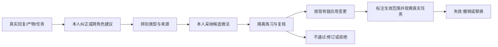

# 公司面培养：从反馈到分身能力的工作台

服务活卡：[Agent 培养](../../issues/2026-10-13-agent-cultivation.md)。研究日期：2026-10-13。
性质：研究建议；不是当前合同、已批 RFC 或实施指令。本轮没有修改 UI、preset、公司事实盘或运行 profile。

## 1. 用户已说清的目标与尚未拍板的解释

用户原意：公司页的“用量”不重要，改成“培养”；培养不同 Agent，CEO 培养自己的 CEO 分身，可给非 CEO 提意见，每个人培养自己。先研究透彻，再落地 issue，目前在推敲，可利用 `_backlog/`。

已确认：入口改为培养；培养围绕不同角色；跨角色有意见通道；本轮先研究。
工作解释：这里的“每个人”首先指驾驭者培养自己的角色分身；CEO 驾驭者与 CEO Agent 的意见均可成为输入，但二者的身份与权限不能混用。一个人可负责多个角色，与现有 owners 配置相容。
尚未确认：培养对象是否需要细到同角色的多个私人分身；CEO 是否只有建议权；是否允许个人偏好长期改变实际行为。这些不能从截图或角色名推出。

**建议的产品目标**：人用真实工作中的证据，持续调整自己的分身，并能看见调整在哪些任务上有效。首次使用应能完成“指出一处问题 → 收到改进建议 → 确认适用范围 → 安排一次验证”，不要求人懂仓库、skill 文件或构建命令。

## 2. 当前事实与问题

| 已确认事实 | 依据 | 设计含义 |
|---|---|---|
| 公司主面第四个子页签为 budget；培养已有独立侧栏类型 | [CompanyView](../../../packages/company-pack/src/client/CompanyView.tsx)、[client 注册](../../../packages/company-pack/src/client/index.ts) | 改入口可复用同一培养领域视图；主面和侧栏不各造一套 |
| 培养侧栏目前显示五角色 journal 计数、标题及本会话赞/踩，并展示开发操作说明 | [CultivationTab](../../../packages/company-pack/src/client/CultivationTab.tsx) | 可复用来源，现有面板还不能兑现角色归属、意见处理、训练和生效 |
| 培养读模型把缺失清单折为 0；注册闭包在失败时返回 null；feedback 的 follow 会寻址 lead | [读模型](../../../packages/company-pack/src/lib/cultivation.ts)、[client 注册](../../../packages/company-pack/src/client/index.ts) | 数据不可达不能呈现成“无待审”；成员页的反馈不能未经归因就算成员的教学输入 |
| 运行学习载体为角色 journal，人收敛入 CHARTER；通用方法论提升进 pack skill | [preset 合同](../../../docs/presets.md)、[已落地培养决定](../../../notes/implemented/2026-09-24-twin-cultivation.md) | journal 清空只证明处理/归档动作，不证明能力变强；应区分材料与已验证能力 |
| persona/组合与 skill 的生效时点不同；角色运行时自改 skill 已否决 | [preset 合同](../../../docs/presets.md) | “已采纳”不能等于“所有会话已生效”；不让分身静默修改正式技能 |
| 人侧归属在 owners；DSH 当前多人形态没有账号级人身份，审批按会话路由 | [owners 起动件](../../../packages/company-pack/workspace/kb/owners.md)、[多人合同](../../../docs/multi-human.md) | 可以做归属提示与操作范围，不能宣称多人安全隔离 |
| CEO spawn 的成员继承 Lead 组合，与独立角色根会话不同 | [运行态地图](../../../docs/runtime-map.md)、[preset 合同](../../../docs/presets.md) | 培养对象不是一个会话名；需说明实际 preset 与训练会话形态 |

现场只读 Inspect 查到当前连接页 conversation.view 有 chat/trajectory，没有 company occupant；它不能证明截图的公司插件挂载状态。本文用仓库钉 SHA 为机制依据；全局安装的 Inspect 只作接口比较线索。详细 pin 核对见 [DSH 能力证据](2026-10-13-dsh-capabilities.md)。

## 3. 从外部实践借什么

完整原句、版本、限制与反证见 [外部证据](2026-10-13-external-patterns.md)。下列是建议，不是对本项目收益的证明。

- [Teachability](https://microsoft.github.io/autogen/0.2/blog/2023/10/26/TeachableAgent/) 展示跨会话保存与按需召回；本项目另外建议可查、可撤销，并分别证明“记住”与“掌握”。
- [Reflexion](https://arxiv.org/abs/2303.11366) 与 [Voyager](https://voyager.minedojo.org/) 提示从真实反馈提炼方法、用环境验证复用；不照搬无限自主探索或自动执行新工具。
- [Anthropic evaluator-optimizer](https://www.anthropic.com/engineering/building-effective-agents) 提示教练循环需要清晰标准、可测价值及停止条件。
- [Anthropic evals](https://www.anthropic.com/engineering/demystifying-evals-for-ai-agents) 提示同时检验新能力和已有行为；单次成功、同题重做和被答案污染的环境都不足以证明成长。
- [LangGraph 记忆分类](https://docs.langchain.com/oss/python/concepts/memory) 可借来区分事实、经历与做法；不因此引入另一个框架或向量记忆库。

## 4. 培养的对象和内容

第一阶段建议对象为“公司盘内的角色分身”，不是临时 teammate、一次聊天或全局模型。界面显示角色、归属者、公司、实际 preset，并连接相关根会话。基础模型权重不属于本轮培养对象。

若同一角色有多个驾驭者或私人分身，当前 role-only 结构不足：需明确“共享角色分身”还是“个人实例”。没有这个需求前不先造账号和实例系统。公司名和角色名相同也不应导致不同公司盘的培养混在一起。

培养内容有四类，选择时说业务语言，保存时回到现有事实 owner：

| 教什么 | 举例 | 建议的落点与审批含义 |
|---|---|---|
| 表达与合作偏好 | 我的 CEO 先给结论，再展开理由 | 部署本地偏好候选；是否进入稳定角色输入仍需确认与机制验证 |
| 工作方法 | 合稿读取权威版本，冲突数字先对账 | 经本人采纳和验证形成角色方法；通用方法再由维护者提升入 pack skill |
| 专业知识 | 新的成本口径、技术限制、来源更新 | 留角色 KB 的事实 owner，带出处及有效时间；不能把未经核实意见写成事实 |
| 公司制度与权限 | 谁签字、毛利底线、谁能承诺 | 走现有公司规矩变更通道；培养动作不授予权限 |

培养记录可表达这四类意图；它不是第二份 KB、CHARTER 或 skill。正文事实仍留原家，记录保留来源、候选改动、采纳理由、目标版本和验证引用。

## 5. 谁能做什么

| 行为 | 本人驾驭者 | CEO 驾驭者对其他角色 | Agent |
|---|---|---|---|
| 提出问题/建议/训练任务 | 可以 | 可以，带来源与期望结果 | 可以提候选，署会话与角色 |
| 管理本人培养目标、决定采纳/拒绝 | 可以，按当前归属约定 | 建议由目标角色本人决定 | 可解释或草拟，不能替人授予采纳权限 |
| 指出公司共同规范冲突 | 可以升级 | 可以提出规范要求，制度另走原通道 | 可以指出冲突，保留专业域判断 |
| 修改正式 preset/通用技能与发布 | 目前须维护者按既有链处理 | CEO 身份不自动得到 repo 发布权限 | 当前分身不能自行改正式 skill |
| 认定能力已验证 | 看明确标准和实际证据 | 可提供复核，不能以职位替代专业验证 | 可运行检查、提供判断；不能靠自评制造“已掌握” |

“CEO 提意见”不等于 CEO 覆盖 CFO 的专业规则。双方意见矛盾时记录适用场景、证据与拒绝理由；公司制度冲突交原制度 owner，不把专业分歧变成不服从。

上表是建议的产品规则。现有 owners 是政策配置，不是可认证物理人的身份凭证；同一 launch token 的浏览器不能证明是谁。首版可声明为单操作者/可信协作，不标榜隔离。授权动作须用可用的人专用边界；若钉版本做不到，保留人工交接，不把前端隐藏按钮当安全保障。

## 6. 核心闭环：一个问题如何长成能力

人可随时提出训练意图，不必先有失败；但系统不虚构失败依据。默认只选一项具体目标，例如“收口时不遗漏未决项”。建议记录最小信息：目标角色、提出者来源、原始材料坐标/文件版本、问题、期望行为、适用范围、候选做法、本人决定、验证与生效引用。

详细材料按需打开；首页不注入全部历史。Agent 读取的是经过筛选的任务相关经验，候选建议不自动变成长期指令。本人一句口头纠正可帮助本次会话；想跨会话持续生效，再确认范围并生成具体可审阅变更。

不要把材料处理、采纳、应用和验证塞成一个“升级成功”状态。可以分别显示：意见待处理/已采纳/拒绝；变更尚未应用/已应用到哪个版本；证据尚未验证/在哪个用例通过/回归或失效。命名在 issue 收敛时再定，当前不是数据库 schema。

训练不是把当前任务改到正确就结束：即时修订可证明已纠正这一题；稳定改善须在不预灌答案的新同类题验证，再保护关键旧行为。每个目标先用少量高价值样例，不建通用考试平台。

## 7. 界面应该怎样让人想用

公司页子导航建议成为“看板 / 依赖图 / 在场 / 培养”。用量仍可从已有辅助入口查看，不因培养研究顺带删除统计能力。公司主面与侧栏/浮窗调用同一培养领域视图；展示容器可以不同。

培养首屏以“我的分身”为默认焦点；可信协作下可切角色，未确认归属显示“请选择负责的角色”，不从当前 Lead 或默认 ceo 猜人身份。

1. **分身概况**：职责、归属、当前生效配置，近期重点一句话，例如“练习在合稿前发现口径冲突”。
2. **需要我处理**：给我的培养建议、我提交的纠正、待确认的具体改动；显示来源和一句证据，展开再看上下文。需人审批的事项链接原待办，不造第二套审批收件箱。
3. **当前培养目标**：期望行为、代表任务、当前进展、下一次练习；能暂停或关闭，证据不足诚实显示。
4. **已采纳的做法与验证记录**：为什么采纳、适用范围、版本、何时生效、最近验证和撤销入口。

常用动作可为“教一句”“从这次工作复盘”“给某角色提建议”“验证这项做法”。首版选最少动作；页签不替人跑无界自动教练。

跨角色建议例：CEO 给 CFO 提“预算结论先列假设，避免混用固定成本与边际成本”，引用那次报告；CFO 本人能采纳为练习、请求澄清或拒绝并说明适用范围。CEO 看见处理回执，不得到直接编辑 CFO 方法的按钮。

当前 journal 计数、赞/踩应放到反馈来源中，不占整页。空态分别是“没有建议”“尚未培养”“没有验证记录”或“材料读取失败”；不能因 journal 已收敛就称“培养完成”。对公司用户不展示 repo 命令和 D25 等内部实现术语。

## 8. 如何利用 DSH 插件体系

优先沿已存在的 company-pack Host/Client 与 preset 接缝扩展，不改 vendor、不重造 Agent loop、调度器、聊天页或记忆框架。接口可用性与安装生效要以钉版本和部署形状分别验证。

| 需求 | 先复用什么 | 待核实/边界 |
|---|---|---|
| 页面、侧栏和浮窗 | 现有 conversation.view 公司面与 cultivation tab、dockkit | 主面培养不依赖 team 数据加载成功；主题与可访问性走平台面 |
| 找到原始反馈 | message-feedback、session-query、workspaceFiles | pin 已确证赞/踩不进模型历史；检索不等于送达；须明确有日志的读取路径与目标归因 |
| 持续保存方法与证据 | 现有角色 journal/CHARTER/KB、preset skills；最小新增培养业务记录只留关系和决定 | 原材料收敛后引用不能悬空；模型读到内容须通过有日志的工具结果或受支持输入 |
| UI 和 Agent 提议 | 单一 Host 业务操作，UI Remote 与工具同语义 | 人确认与发布保持人专用；钉版授权边界能否区分 UI/Agent 须验证 |
| 个人方法持续生效 | 比较人工维护链、显式加载已采纳方法、隔离技能根或 provider | 新长期输入会触碰 D8/D25/隔离决定，必须先批准并探针，不说“现成自我学习” |
| 练习与提醒 | 独立角色 preset 根会话、已有排练与检查；schedule 如确有需求 | teammate 不冒充完整角色；上限、取消与成本可见；不默认无人值守互评 |

事实存于公司事实盘，DSH Session 日志记录模型看到/操作过什么；二者用途不同。派生投影可缓存，不能成为另一份权威数据。避免高频扫全部历史，先提供角色摘要与材料坐标，细节按需取。

## 9. 真正需要比较的实现选择

| 候选 | 优点 | 代价与目前判断 |
|---|---|---|
| A. 只把现有培养侧栏放进公司页 | 改动小，来源已在场 | 不能解决本人采纳、持续生效和验证；可作为导航前置，不当完整培养 |
| B. 反馈/目标/建议工作台，通用技能仍走维护链 | 延续现有边界，可先走通人与分身的教学习惯 | 不能承诺点击即跨会话生效；建议先做此闭环，采纳生成可审阅候选与维护交接 |
| C. B 加部署本地、按角色隔离的已采纳方法层 | 目标是每人持续塑造分身，包升级保留个性化 | 根/作用域/沙箱/并发生效及升级/迁移/恢复均待验证；会改变当前培养合同，确认需求后再定机制 |
| D. 运行分身直接改 pack、自动升级或另造向量记忆 | 自动化表象强 | 已有否决和真实归属冲突；本轮不建议，外部案例不构成解禁依据 |

产品方向倾向 C：本人采纳的方法能持续影响自己的角色分身，通用方法再走 pack 维护链。B 可作为先定教学/建议用户路径的过渡闭环，同时用只读源码与受控探针评估 C；不能悄悄以记录页面替代持续培养。如果第一版就要求跨会话教会，C 的机制验证是首版前提，B 不能独立宣称满足培养目标。

## 10. 推敲顺序和待验证问题

先定一个人的完整路径，再决定扩展范围：

| 候选阶段 | 交付结果 | 真正前提 | 如何验收（未来，未执行） |
|---|---|---|---|
| 导航与现状解释 | 公司页培养入口与现有侧栏共用；来源可达与失败可辨 | 培养作为第四入口已由用户提出；具体稿仍须实施授权 | 公司页不再出现用量子页；培养不等 team；缺目录/断流不显示伪 0 |
| 本人教学与跨角色建议 | 一条纠正有来源、目标角色、采纳理由、处理回执与具体候选 | 角色归属粒度、CEO 权限边界定清；存储与人专用动作证明可行 | CEO→CFO 建议由 CFO 驾驭者处理；Agent 提案不能代采纳；重启后记录可找 |
| 持续生效 | 一项采纳的方法在规定会话范围有效且可撤回 | B/C 选择、新输入 owner、角色隔离与生效边界通过探针 | CFO 新根会话可用；CEO/其他公司不误加载；旧会话按真实机制标时点 |
| 能力验证与观察 | 一个目标的前后对比和关键回归记录 | 实际目标/样例/标准由人或既定合同定清 | 新同类题而非原题复述；重复表现和成本列明；失败不显示已掌握 |

这些是判断依赖，不是已授权执行队列。目前不批量拆子 issue，也不登记 GitHub issue。

pin 源码已确认 scoped skill provider 与 customSkillDirs 存在；它们能否符合本项目的角色与公司边界仍待探针。最值得先探的问题：额外 role skill 根如何绑定 cwd；Agent 可写候选内容能否避开正式加载面；已采纳方法如何跨会话且不串角色；独立训练根会话能否限定权限和预算；log-only feedback 如何经授权读取进入有日志的模型输入；数据版本与原材料收敛如何保留可追溯引用。本轮未做活体探针。

## 11. 下一次讨论只聚焦一个人的闭环

建议用一个实例定方向：CEO 驾驭者发现自己的分身合稿漏掉未决项，提交纠正；分身提炼“收口前逐项列未决”；本人采纳；在另一份合稿中验证；显示具体改了什么、在哪生效、哪里仍不可靠。

当前最关键的人的选择：**第一版是先有可交接的教学/建议工作台，还是必须做到本人采纳后跨会话持续影响分身？** 前者可沿现行维护链起步，后者需明确引入部署本地方法层并重新验证已有边界。对此尚未替用户拍板。
