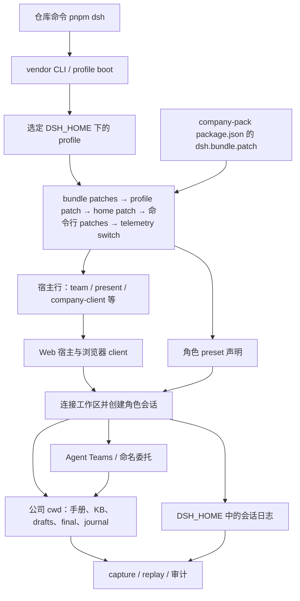

# 项目地图：从入口到证据

这份地图供项目驾驭者与维护 Coding Agent 使用。根 [AGENTS.md](../AGENTS.md) 路由开发任务；[公司手册](../company-workspace/AGENTS.md) 是角色会话的运行时输入。先用下表选入口，政策和操作细节由链接目标维护。

**快读（happy path）**：启动公司 → [demo.md §前置](demo.md)；改东西 → 下表按任务进入；验证 → [tests/README](../tests/README.md) 最窄检查表；卡住 → 本页「交互与调试入口」现象表；时序与状态轴 → [运行态地图](runtime-map.md)。

## 按任务进入

| 当前目的 | 入口 | 读完能做什么 |
|---|---|---|
| 第一次进入或还不能启动 | [引导指南](guides/bootstrap.md) | 安装 workspace、构建 host/client 与 Web 产物 |
| 开始代码或文档变更 | [开发环](guides/dev-loop.md) §0.5/§1 | 判断任务、范围、授权与完成证据 |
| 启动并操作公司 | [动议合同](demo.md) §前置 | 打开带 token 的观察窗、连接公司盘、创建 CEO 会话 |
| 查运行态与时序 | [运行态地图](runtime-map.md) | 分清代码/运行态/会话事实/证据四轴与首跑错误入口 |
| 查组合和工具装载 | [profile 合同](profile.md)、[开发环](guides/dev-loop.md) §2 | dump 组合、检查名册与实际会话挂载 |
| 修改角色内容 | [preset 合同](presets.md) | 找到 persona、skill 与 workspace 事实的各自 owner |
| 修改 host 或 Web | [源码地图](../packages/company-pack/src/README.md) | 找到注册入口、读模型与渲染实现 |
| 选择验证 | [测试宪法](testing.md)、[tests/README](../tests/README.md)、[脚本索引](../checks/README.md) | 选择证明当前性质的最窄检查 |
| 查证据与归档 | [快照规则](../snapshots/README.md) | 区分录制、副本、独立 oracle、视觉夹具和归档 |
| 查设计理由或旧决定 | [主题导航与决策台账](index.md) | 从主题进入合同和关联 Note |

## 运行、开发、排练与证据各在哪里

| 面 | 位置 | 所有权与用途 |
|---|---|---|
| 自写运行包 | [company-pack](../packages/company-pack/) | 五个角色 preset、bundle 行、host 注册与 client 面；发布形状由 [包声明](../packages/company-pack/package.json) 决定 |
| 真实公司盘 | [company-workspace](../company-workspace/) | 公司角色会话 cwd；本部署的业务数据（owners、台账、journal、交付物；**drafts/sources 不进 git**，2026-10-13 起）+ 制度件的**符号链接入口**；制度的家 = [pack workspace](../packages/company-pack/workspace/)（出厂骨架、随包分发） |
| 启动配置 | [run](../run/)、[env.sh](../run/env.sh) | tracked 启动配置；源码验证使用开发 DSH_HOME |
| 运行残留 | [runtime](../runtime/)、[runtime/README](../runtime/README.md) | 开发 DSH_HOME、第二 home、浏览器工具态与排练盘（mostly gitignored，少数 tracked 逐件见 runtime/README；排练盘成型见 [rehearsal 实现](../tools/lib/rehearsal.mjs)） |
| 上游机制 | [vendor/dsh](../vendor/dsh/) | 钉住的只读 submodule；开发 `pnpm dsh` 的源码基线 |
| keyless 回归 | [tests](../tests/)、[Vitest 配置](../vitest.config.ts) | 模块逻辑、静态渲染、隔离文件夹具；分层守卫见 [layering.spec.ts](../tests/harness/layering.spec.ts) |
| 维护工具 | [检查与工具索引](../checks/README.md) | 门禁、真实入口、窄探针、审计、回放与导出；共享实现位于 [tools/lib](../tools/lib/) |
| 固化证据 | [snapshots](../snapshots/README.md) | 按场景保留日志、sidecar、工作区与判据；按日期保存归档证据 |
| 当前合同 | [docs](index.md) | 当前语义与操作方式；本地图负责路由 |
| 决策记忆 | [notes](../notes/) | 按主题检索决定、被否决方案与复验依据 |
| 推敲空间 | [_backlog](../_backlog/README.md) | 未成熟判断材料；任务执行按开发环与用户指令进入 |

**四个位置影响运行**：**代码来源**决定 DSH 版本、**DSH_HOME** 决定 profile 与会话日志、**会话 cwd** 决定公司事实和输出、**验证证据**冻结时点事实——四条状态轴的权威位置与「不能从这里推断什么」唯一家 = [运行态地图 §二](runtime-map.md)。开发环境用 `source run/env.sh` 与 `pnpm dsh` 配对；裸 `dsh` 是另一份全局安装。[开发环 §6](guides/dev-loop.md) 解释双 home 与双 DSH。

## 真实运行链

图中实体对应以下真实入口：

- [根包命令](../package.json) 将 `pnpm dsh` 接到 [vendor CLI](../vendor/dsh/apps/cli/src/bin.ts)；[profile boot](../vendor/dsh/apps/cli/src/profile-boot.ts) 按选择的 profile 装配 patch 层；home patch（`$DSH_HOME/cordis.patch.yml`）在 profile patch 之后生效，随后是命令行 `--patch` 与 telemetry switch。
- [company-pack 包声明](../packages/company-pack/package.json) 的 `dsh.bundle.patch` 合并 [共享 patch](../packages/company-pack/cordis.patch.yml) 与五个角色 preset + 一个委派子人格 preset（`researcher`）文件；[CEO preset](../packages/company-pack/presets/ceo/agent.cordis.yml) 声明 persona、角色 skills 和会话工具。
- `company-client` 行接到 [host 入口](../packages/company-pack/src/index.ts)，注册签字工具；[client 入口](../packages/company-pack/src/client/index.ts) 注册品牌、卡片和公司视图，并读取官方会话投影。
- 公司手册与事实由会话 cwd 进入；[排练实现](../tools/lib/rehearsal.mjs) 为实验换 cwd、刷新参考输入并保留排练产物。

**公司完整操作走 Web profile。** shipped headless 是通用 CLI 面，单独运行它不会自动得到公司组合。headless 实验需要显式组合；[company overlay](../run/company.overlay.yml) 只补部分宿主行，实际组合还由调用脚本的 preset patches 决定。不要把“CLI 可启动”当作“五角色公司已装配”。

**团队成员与独立角色 preset 会话有不同隔离语义。** preset 会话挂自己的角色组合；team teammate 的工具、身份与 KB 使用按团队机制走。选择通道时读 [委派合同](delegation.md) 和 [角色隔离设计](design/roles-isolation.md)，不要从角色名字推断它已挂完整 preset。

## 交互与调试入口

Web 操作按 [动议合同 §前置](demo.md) 执行：启动输出给出当前 token URL；浏览器连接公司盘、创建 CEO 会话；团队名册或在场板进入成员会话。签字与人机停点见 [多人合同](multi-human.md)；呈现前的机器走查见 [CDP 指南](guides/cdp-probe.md)。端口、token 与当前进程状态以本次启动输出为准。

| 现象 | 从哪一层查 | 下一步证据 |
|---|---|---|
| 公司角色没有出现 | profile 与最终组合 | `pnpm dsh --profile web --dump-config`，核对 bundle/preset 行 |
| 名册有角色但创建失败 | 实际 preset 挂载 | [preset-smoke](../checks/smoke/preset-smoke.mjs)，dump/名册扫描不能证明 schema 挂载成功 |
| 工具缺失或委派续驶不可达 | 会话组合、工具目录、团队名册 | [delegation-smoke](../checks/smoke/delegation-smoke.mjs) 与对应机制探针 |
| 改动没进入当前会话或页面 | 生效方式与构建产物 | [开发环 §2](guides/dev-loop.md)、[构建指南](guides/bootstrap.md)、[培养合同](presets.md) |
| 页面挂载或面板异常 | client 装配与真实渲染 | [client-load-smoke](../checks/smoke/client-load-smoke.mjs)、[cdp-probe](../probes/browser-visual/cdp-probe.mjs) |
| 交付物、作者或 journal 不对 | 会话日志与实际工作区 | [deliverables-check](../checks/audit/deliverables-check.mjs)、[authorship-audit](../checks/audit/authorship-audit.mjs)、[journal-audit](../checks/audit/journal-audit.mjs) |
| 会话行为回归 | 录制场景与明确判据 | [replay-smoke](../checks/smoke/replay-smoke.mjs)，按场景声明检查 oracle |

## 测试资产怎样串起来

局部逻辑先由 `pnpm test` 给反馈；结构与链接由 `pnpm verify` 检查；装配、机制、CLI 和浏览器检查由脚本进入真实路径。真模型与 E2E 按改动面触发，具体证明范围以 [测试宪法](testing.md) 为准。

资产关系是：**模块 spec → 真实入口脚本 → 场景判据/固化证据**。回放场景保存录制和 sidecar；工作区 oracle 要看场景声明，历史 `workspace.expected` 中有录制副本，名字本身不证明独立编写。`workspace.actual` 是时点副本，live 公司盘则继续演进。视觉夹具使用合成输入，行为质量语料有独立标注；这些资产都由 [快照规则](../snapshots/README.md) 和场景自身说明用途。

## 目录整理结论

顶层按**用途**读（2026-10-07 S1–S3，RFC [driver-purpose-top-level](../notes/archived/2026-10-07-driver-purpose-top-level.md)）：**运行 = run/**（env.sh + overlay）、**验证 = checks/**（smoke + audit + run-gates）、**调试 = probes/**（按机制域四子目录）、**工具 = tools/**（含 lib/drivers/archive）；keyless spec 按 company/client/presets/harness 领域归位；`scripts/`、`dev/` 两个形态名目录已退役。长期收益是目录本身回答“该改哪类资产、从哪个用途进”，索引回答“该选哪个入口”；不把搬迁成本当作保持平铺的理由。根 [run-gates](../checks/run-gates.mjs) 保持完整稳定入口；门禁自 2026-10-14 拆成 checks/gates/ 模块（清单唯一源 = gates/ 目录，pin 常量 = gates/lib/pin.mjs）。取舍 = [driver-purpose-top-level](../notes/archived/2026-10-07-driver-purpose-top-level.md)。
